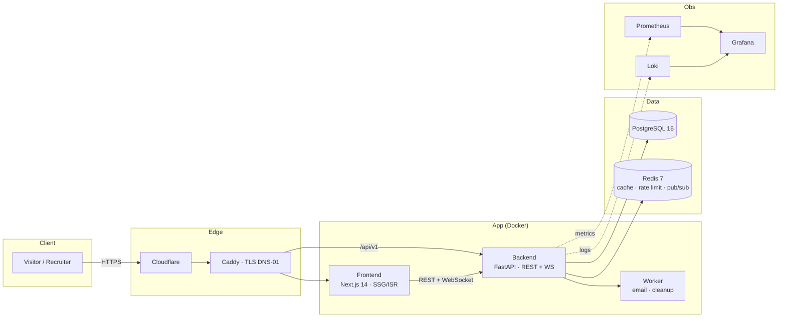

# Blue-Sentinel

> Personal Cybersecurity portfolio — Blue Team & Detection Engineering, built as a production-grade full-stack system (Next.js + FastAPI + PostgreSQL/Redis) with an interactive detection lab, 28 defensive Sigma/YARA rules and a C++20 telemetry agent.

[](https://github.com/pedro12345lisboa-sudo/blue-sentinel-security/actions/workflows/ci.yml)
[](https://github.com/pedro12345lisboa-sudo/blue-sentinel-security/actions/workflows/agent.yml)
[](LICENSE)
[](docs/screenshots/README.md)

**100% defensive, synthetic data only.** No malware, no exploits, no live payloads — every log, host and IP in the lab is fictional (RFC 5737 documentation ranges). All personal details are placeholders (`[SEU NOME]`…) or `NEXT_PUBLIC_*` environment variables; see [Personal data](#personal-data).

---

## Table of contents

- [Screenshots](#screenshots)
- [What it does](#what-it-does)
- [Architecture](#architecture)
- [Stack — and why](#stack--and-why)
- [Quick start (Docker, 5 commands)](#quick-start-docker-5-commands)
- [Environment variables](#environment-variables)
- [Project structure](#project-structure)
- [Detection rule library](#detection-rule-library)
- [SEO & sharing](#seo--sharing)
- [Case study](#case-study)
- [Roadmap](#roadmap)
- [Documentation map](#documentation-map)
- [Ethical use](#ethical-use)
- [License](#license)

## Screenshots

> Capture guide (1440×900, dark theme) and GIF recipe: [docs/screenshots/README.md](docs/screenshots/README.md).
> Once captured, uncomment the embeds below — the files live in `docs/screenshots/`.

<!--

| Home (3D slot) | Detection lab mid-incident | Case study |
|---|---|---|
|  |  |  |

| Security | Status | Lab GIF |
|---|---|---|
|  |  |  |

-->

## What it does

**Frontend (portfolio site)**

- Static-first Next.js 14 App Router site, i18n PT-BR/EN with `hreflang` + canonical on every page
- MDX content pipeline for projects, writeups, playbooks and hunting hypotheses
- Interactive **detection lab** (`/lab`): WebSocket synthetic events → Sigma/YARA/correlation engine → auto-built incident timeline (real rules from `rules/`)
- Live **status page** (`/status`): CPU/RAM/disk/network, DB/Redis latency, API health
- GSAP motion (respects `prefers-reduced-motion`), WCAG AA accessibility, dark SOC visual identity
- Full SEO: per-page metadata, dynamic Open Graph images (1200×630), JSON-LD, `robots.txt`, `sitemap.xml`, RSS

**Backend (FastAPI)**

- Health (`/live`, `/ready`), rate-limited contact form with honeypot + async email worker
- WebSocket lab server with session tickets, backpressure and degrade modes
- JWT admin area, HMAC-protected alert webhook, Prometheus metrics, Loki/Grafana stack
- Retention cleanup (LGPD): contacts 90d, lab sessions 30d

**Agent (C++20 showcase)**

- Read-only telemetry agent (CMake + GoogleTest + CI) with HMAC-signed payloads — [agent/README.md](agent/README.md)

## Architecture



Deep dives: [overview](docs/architecture/overview.md) · [flows](docs/architecture/flows.md) · [data model](docs/architecture/data-model.md) · [infrastructure](docs/architecture/infrastructure.md) · [ADRs](docs/architecture/adr/).

## Stack — and why

| Layer | Technology | Why this one |
|---|---|---|
| Frontend | **Next.js 14 + TypeScript** | App Router + Metadata API give per-page SEO (canonical, OG, JSON-LD) with static-first rendering — a portfolio must be fast and indexable without a backend |
| Styling | **Tailwind CSS + design tokens** | Tokens generated from Figma keep PT/EN UI consistent; utility classes keep the dark SOC theme small |
| Content | **MDX (next-mdx-remote)** | Writeups need code blocks and custom components; MDX keeps articles in git, versioned and reviewed like code ([ADR 001](docs/architecture/adr/001-content-in-mdx.md)) |
| Motion | **GSAP** | Scroll-triggered storytelling with a single `prefers-reduced-motion` guard for accessibility |
| Backend | **FastAPI + Pydantic** | Async by default (WebSocket lab + REST), schema validation identical in OpenAPI and tests ([ADR 003](docs/architecture/adr/003-fastapi-for-backend.md)) |
| Database | **PostgreSQL 16** | Relational integrity for contact messages, lab sessions and admin users; plain SQL, no ORM magic |
| Cache/queue | **Redis 7** | One store, three jobs: sliding-window rate limiting (Lua), GitHub-stats cache with stampede protection, pub/sub for lab alerts ([ADR 002](docs/architecture/adr/002-redis-for-cache-queue.md)) |
| Detection | **Sigma/YARA (custom engine)** | The lab evaluates the *same* rule files defended in the writeups — dogfooding, not a mock |
| Agent | **C++20 + CMake + GoogleTest** | Telemetry agents live on constrained endpoints: deterministic memory, no runtime, signed payloads |
| Observability | **Prometheus + Loki + Grafana** | Dual-path metrics/logs; alert rules feed the same webhook the site dogfoods |
| Production | **Caddy + Cloudflare + age backups** | Automatic TLS (DNS-01), origin locked to Cloudflare, encrypted backups synced to S3 with tested restore |

## Quick start (Docker, 5 commands)

```bash
git clone https://github.com/pedro12345lisboa-sudo/blue-sentinel-security.git
cd blue-sentinel-security
cp .env.example .env          # review values — dev defaults are fine locally
docker compose up --build
# Frontend: http://localhost:3000 · API docs: http://localhost:8000/api/v1/docs
```

Health check: `curl http://localhost:8000/api/v1/health/ready`

Without Docker:

```bash
cd frontend && pnpm install && pnpm dev      # http://localhost:3000
cd backend  && pip install -r requirements.txt && uvicorn main:app --reload
```

## Environment variables

All variables are documented with safe defaults in [`.env.example`](.env.example). The most relevant:

| Variable | Purpose | Default |
|---|---|---|
| `NEXT_PUBLIC_SITE_URL` | Canonical base URL (canonical, OG, sitemap, RSS) | `http://localhost:3000` |
| `NEXT_PUBLIC_OWNER_NAME` / `_CONTACT_EMAIL` / `_LINKEDIN_URL` / `_GITHUB_URL` / `_PHONE` | Personal data overrides — **unset ⇒ placeholders** | *(empty)* |
| `SECRET_KEY`, `AGENT_HMAC_SECRET` | App + agent HMAC secrets (**must** change in prod) | dev placeholders |
| `RATE_LIMIT_FAIL_CLOSED` | Redis down ⇒ block (`true`) or allow (`false`) | `false` |
| `CONTACT_RETENTION_DAYS`, `LAB_SESSION_RETENTION_DAYS` | LGPD retention windows | `90`, `30` |
| `EMAIL_PROVIDER` | `console` \| `sendgrid` \| `resend` \| `smtp` | `console` |

### Personal data

The repository never contains real personal information. `frontend/messages/*.json` ships
placeholders (`[SEU NOME]`, `[SEU EMAIL]`, `[SEU LINKEDIN]`, `[SEU GITHUB]`); setting the
`NEXT_PUBLIC_*` variables in your local `.env` (or in the deployment environment) replaces
them everywhere — UI, JSON-LD and contact links.

## Project structure

```
blue-sentinel/
├── frontend/               # Next.js 14 (App Router, i18n, MDX, SEO, lab UI)
│   ├── src/app/            # Routes, metadata, robots/sitemap/RSS, OG images
│   ├── src/components/     # UI, sections, MDX, lab, status, seo/
│   ├── content/{pt,en}/    # MDX: projects, writeups, playbooks
│   ├── messages/           # i18n dictionaries (placeholders for personal data)
│   └── tests/              # Vitest unit + Playwright e2e/a11y
├── backend/                # FastAPI app (API, detection engine, workers, tests)
├── agent/                  # C++20 telemetry agent (CMake, GoogleTest)
├── rules/                  # 20 Sigma · 5 YARA · 3 correlation patterns
├── docker/                 # Caddy, Prometheus, Loki, Grafana configs
├── scripts/                # deploy, rollback, backup/restore, harden, validate_rules
└── docs/                   # architecture, api, security, screenshots, pitch
```

## Detection rule library

Defensive-only rules evaluated by the `/lab` engine and by CI. Every rule matches **synthetic**
logs; the repository ships no malware, no exploit and no live payload.

- **20 Sigma rules** (`rules/sigma/{windows,linux,web,cloud}`) — UUID, ATT&CK tags, explicit false positives
- **5 YARA rules** (`rules/yara`) and **3 correlation patterns** (`rules/patterns`)
- **50 fixtures** (positive + negative per rule) — hit-rate **50/50 (100%)** in CI

```bash
python scripts/development/validate_rules.py     # schema, UUIDs, ATT&CK, fixture hit-rate
```

| Doc | Answers |
|---|---|
| [Detection catalog](docs/security/detection-catalog.md) | What each rule detects, source, severity, false positives |
| [ATT&CK coverage](docs/security/attack-coverage.md) | Tactic × technique matrix **and the known gaps** |
| [Tuning guide](docs/security/tuning-guide.md) | Cutting false positives without disabling detections |
| [Threat model](docs/security/threat-model.md) · [Hardening](docs/security/hardening.md) | STRIDE analysis and the implemented baseline |

## SEO & sharing

- Per-page metadata: title ≤ 60 chars, description ≤ 160, canonical + `hreflang` (PT/EN), Open Graph and Twitter Card
- Dynamic OG images (1200×630, dark theme) generated per route via `next/og` — site-wide, per project and per writeup
- JSON-LD: `WebSite` + `Person` (home), `Article` (writeups), `SoftwareSourceCode` (projects)
- `robots.txt` (blocks `/api/` and `/admin`), `sitemap.xml` with all public URLs + `lastmod`, RSS feed at `/rss.xml`
- API and admin responses carry `X-Robots-Tag: noindex`

Verify locally: `curl -s localhost:3000/robots.txt`, `curl -s localhost:3000/sitemap.xml | head`,
`curl -s localhost:3000/rss.xml | head`, or inspect any page source for `og:image` / `application/ld+json`.

## Case study

**Problem.** Portfolios in security are usually static résumés. Recruiters can't *see* detection
skills, and candidates can't prove how they think. The goal: a site that demonstrates Blue Team
work by running it — detection rules, incident timelines, honest operational metrics.

**Decisions.**

- *Dogfood the detection engine*: the `/lab` evaluates the exact Sigma/YARA files published in
  `rules/` — the writeups, the rules and the UI can't drift apart.
- *Static-first with a thin dynamic core*: content pages are SSG/ISR (fast, indexable, resilient);
  only the lab, status and contact touch the API.
- *Redis as the only shared state* for rate limiting, cache and pub/sub ([ADR 002](docs/architecture/adr/002-redis-for-cache-queue.md)).
- *Everything synthetic*: event generator uses RFC 5737 IPs and fictional hosts — safe to demo anywhere.

**Challenges.**

- Sliding-window rate limiting that degrades predictably when Redis is down → explicit
  `RATE_LIMIT_FAIL_CLOSED` switch (fail-open in dev, fail-closed on the public site).
- WebSocket lab with backpressure: bounded queues, session tickets, paced event feed and
  degrade modes instead of silently dropping events.
- Keeping 28 rules honest: CI validates schema, unique UUIDs, ATT&CK tags and fixture hit-rate.

**Results (measured in CI / locally).**

| Metric | Value |
|---|---|
| Detection fixtures hit-rate | 50/50 (100%) — `validate_rules.py` in CI |
| Backend tests | 280+ (unit, integration, contract, security) — `pytest` |
| Frontend tests | 115 passing across 17 files — `pnpm test` (Vitest) |
| Accessibility/SEO | Lighthouse SEO & Accessibility target ≥ 95 on all public pages ([run the audit](docs/screenshots/README.md)) |
| Retention | automated LGPD cleanup: contacts 90d, lab sessions 30d |

## Roadmap

- [ ] Expand ATT&CK coverage to the documented gaps ([coverage matrix](docs/security/attack-coverage.md))
- [ ] Wire the C++ agent's signed telemetry into the lab ingestion path
- [ ] Correlation rules v2: multi-host chains with risk scoring
- [ ] Automated Lighthouse budget in CI (SEO/A11y ≥ 95 gate)
- [ ] Playbook viewer v2: printable IR worksheets per scenario
- [ ] Public status history page backed by Prometheus exports

## Documentation map

| Doc | Content |
|---|---|
| [docs/architecture/](docs/architecture/) | Overview, flows, data model, infrastructure, observability, runbook, DR, ADRs |
| [docs/api/](docs/api/) | OpenAPI spec, auth, error contract, WebSocket protocol |
| [docs/security/](docs/security/) | Threat model, hardening, detection catalog, ATT&CK coverage, severity, tuning, data inventory |
| [docs/portfolio-pitch.md](docs/portfolio-pitch.md) | 30-second pitch and interview Q&A (PT-BR) |
| [docs/testing.md](docs/testing.md) | Test strategy and commands |
| [CONTRIBUTING.md](CONTRIBUTING.md) · [SECURITY.md](SECURITY.md) | Workflow and responsible disclosure |

## Ethical use

Blue-Sentinel is an **educational, defensive** project. The lab runs synthetic events only; the
detection rules inspect log lines and never execute anything. The repository contains **no**
malware, exploit or payload, and grants **no** authorization to attack any system. Use the
techniques documented here to **detect and defend**, on systems you own or are explicitly
authorized to test. Vulnerability reports: see [SECURITY.md](SECURITY.md).

## License

[MIT](LICENSE)
