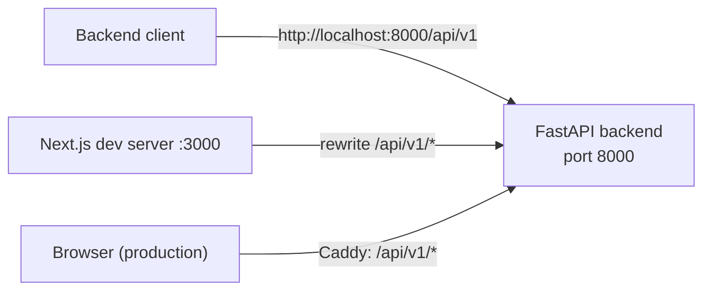

# Blue-Sentinel API Reference

Technical reference for the FastAPI backend (`backend/`) of the Blue-Sentinel
cybersecurity portfolio. Every statement below is derived from the source code
(`backend/main.py`, `backend/app/api/v1/*`, `backend/app/core/*`,
`backend/app/middleware/*`). The machine-readable contract is committed at
[`openapi.json`](./openapi.json).

## Contents

- [Base URL and versioning](#base-url-and-versioning)
- [Interactive documentation](#interactive-documentation)
- [Content types](#content-types)
- [Request ID](#request-id)
- [Error envelope](#error-envelope)
- [Rate limiting](#rate-limiting)
- [CORS](#cors)
- [Pagination and filtering](#pagination-and-filtering)
- [Endpoint map](#endpoint-map)
- [Regenerating the OpenAPI spec](#regenerating-the-openapi-spec)

## Base URL and versioning

All HTTP routes are mounted under the prefix `/api/v1`
(`Settings.api_v1_str`, default `/api/v1`, `API_V1_STR`; routers are included
in `backend/main.py:193-201`).

| Deployment | Base URL |
| --- | --- |
| Backend container / local uvicorn (`Dockerfile`: `--port 8000`, compose `8000:8000`) | `http://localhost:8000/api/v1` |
| Next.js dev server (rewrite `/api/v1/:path*` → `BACKEND_INTERNAL_URL`, default `http://localhost:8000`) | `http://localhost:3000/api/v1` |
| Production | `https://<DOMAIN>/api/v1` (Caddy forwards `/api/v1/*` to `backend:8000`) |



The only unversioned application route is `GET /`, which returns
`{"message": "Blue-Sentinel API", "version": "0.1.0"}` (FastAPI additionally
serves the spec itself at `/openapi.json`).

## Interactive documentation

| Resource | URL |
| --- | --- |
| Swagger UI (`docs_url`) | `/api/v1/docs` |
| ReDoc (`redoc_url`) | `/api/v1/redoc` |
| OpenAPI document served by FastAPI (`openapi_url`) | `/openapi.json` |
| Committed copy (this folder) | [`docs/api/openapi.json`](./openapi.json) |

The WebSocket route is **not** described by the OpenAPI document (FastAPI does
not serialize WebSocket operations); see [`websocket.md`](./websocket.md).

## Content types

- **Requests:** `application/json` for every JSON body
  (`POST /contact`, `POST /auth/login`, `POST /admin/messages/read`,
  `POST /alerts/webhook`). The lab WebSocket uses JSON text frames.
- **Success responses:** `application/json` (Pydantic `response_model` or
  `JSONResponse`). Status codes: `200`, `201` (`POST /lab/sessions`),
  `202` (`POST /contact`).
- **Errors:** two families — `application/problem+json` (RFC 9457) produced by
  the handlers in `backend/main.py` and by the helper in
  `backend/app/api/v1/alerts.py`, and a plain `application/json` envelope
  produced by the `BlueSentinelError` handler
  (`backend/app/core/errors.py`). Both are documented in
  [`errors.md`](./errors.md).
- Prometheus exposition (`text/plain; version=0.0.4`) would be returned by
  `backend/app/api/v1/metrics.py`, but that router is **not** registered in
  `main.py`, so `/api/v1/metrics` is not served.

## Request ID

`backend/app/middleware/request_context.py` runs as the outermost middleware
(registered last in `backend/main.py:136-138`), so every request gets an ID
before routing:

- Client may supply `X-Request-ID`. It is reused only if it matches
  `^[A-Za-z0-9_-]{8,64}$` (anti log-forging); otherwise a new
  `uuid.uuid4().hex[:12]` is generated.
- The ID is stored in `request.state.request_id`, propagated to the structured
  JSON logs, and echoed back in the response header `X-Request-ID`.
- It also appears in every error payload (`request_id` field).
- The same middleware records per-route latency/error metrics, increments the
  401/429 counters, and feeds the site-monitoring "dogfooding" events.

Logs contain the route, status and duration only — never the query string, the
request body or the client IP.

## Error envelope

Failures return a stable machine-readable `code` that the frontend translates
through `site.errors[code]`. Short example (full table in
[`errors.md`](./errors.md)):

```json
{
  "type": "about:blank",
  "title": "Validation Error",
  "status": 422,
  "code": "VALIDATION_ERROR",
  "detail": "body.name: Field required",
  "request_id": "6f1c0b2d9a74"
}
```

`Content-Type: application/problem+json`.

## Rate limiting

| Route | Limit | Window | Storage | Breach |
| --- | --- | --- | --- | --- |
| `POST /api/v1/contact` | 10 requests per client IP | 60 s | Redis sliding window (`CONTACT_IP_RATE_LIMIT` / `CONTACT_IP_RATE_WINDOW_SECONDS`, `backend/app/api/v1/contact.py:21-22`) | `429` + `Retry-After` |
| `POST /api/v1/contact` | 5 requests per e-mail address | 1 hour | Postgres count (`CONTACT_RATE_LIMIT`, `backend/app/services/contact_service.py:17`) | `429` + `Retry-After: 3600` |
| `POST /api/v1/lab/sessions` | 10 requests per client IP | 600 s | In-memory (`SESSION_RATE_LIMIT` / `SESSION_RATE_WINDOW_SECONDS`, `backend/app/services/lab_service.py:35-36`) | `429` + `Retry-After` |

- The Redis limiter uses an atomic Lua sliding-window script
  (`backend/app/middleware/rate_limit.py`).
- Redis outage policy: **fail-open** by default (`RATE_LIMIT_FAIL_CLOSED=false`);
  set `RATE_LIMIT_FAIL_CLOSED=true` for fail-closed (blocked limited requests).
- Every `429` and `401` is counted per route in the metrics registry.

## CORS

`backend/main.py:128-134`:

- **Origins:** `ALLOWED_HOSTS` split on `,` (default
  `localhost,127.0.0.1,[::1]`); `["*"]` when `DEBUG=true` (the default in
  `.env.example`).
- **Credentials:** allowed (`allow_credentials=True`).
- **Methods:** `GET`, `POST`, `PUT`, `PATCH`, `DELETE`, `OPTIONS`.
- **Headers:** `Authorization`, `Content-Type`.

## Pagination and filtering

Only `GET /api/v1/admin/messages` is paginated/sortable:

| Parameter | Type | Default | Bounds |
| --- | --- | --- | --- |
| `skip` | int | `0` | `0 ≤ skip ≤ 1000` |
| `limit` | int | `50` | `1 ≤ limit ≤ 100` |
| `sort` | string | `created_at` | allowlist: `created_at`, `id`, `subject`, `email` |
| `direction` | string | `desc` | `asc` or `desc` |

Response shape: `{"items": [MessageSummary], "total": int}`. The sort column is
validated against an allowlist before touching the database; an unknown column
or direction returns `400 VALIDATION_ERROR`. There is no cursor pagination and
no other filtering parameters in the API.

## Endpoint map

| Group | Endpoints | Authentication | Reference |
| --- | --- | --- | --- |
| Root | `GET /` | public | this file |
| Contact | `POST /api/v1/contact` | public (rate limited + honeypot) | [`errors.md`](./errors.md#429-too-many-requests) |
| GitHub stats | `GET /api/v1/github/stats` | public (Redis cache, `CACHE_TTL = 3600` s) | [`openapi.json`](./openapi.json) |
| Lab (REST) | `POST /api/v1/lab/sessions`, `GET /api/v1/lab/scenarios`, `GET /api/v1/lab/rules`, `GET /api/v1/lab/rules/{rule_id}` | public (session creation rate limited) | [`openapi.json`](./openapi.json) |
| Lab (WebSocket) | `GET /api/v1/ws/lab/{session_id}` (upgrade) | ticket query parameter | [`websocket.md`](./websocket.md) |
| Status | `GET /api/v1/status` | public | [`openapi.json`](./openapi.json) |
| Health | `GET /api/v1/health/live`, `GET /api/v1/health/ready` | public | [`openapi.json`](./openapi.json) |
| Auth | `POST /api/v1/auth/login` | public | [`authentication.md`](./authentication.md) |
| Admin | `GET /api/v1/admin/messages`, `POST /api/v1/admin/messages/read` | JWT Bearer + admin role | [`authentication.md`](./authentication.md#protected-routes) |
| Monitoring | `POST /api/v1/alerts/webhook` | `ALERT_WEBHOOK_TOKEN` | [`authentication.md`](./authentication.md#alertmanager-webhook) |

> Note: `backend/app/api/v1/metrics.py` defines a token-protected
> `GET /metrics` route, but `main.py` never includes that router, so it is not
> part of the served API today.

## Regenerating the OpenAPI spec

The committed spec is a real export produced from the running application
object. It requires the project virtualenv (FastAPI/Pydantic) but **no**
database, Redis or `.env` file — nothing performs I/O at import time.

From the repository root — this is the exact command used to produce the
committed file (verified on Windows):

```powershell
.venv\Scripts\python.exe -c "import json,sys; sys.path.insert(0,'backend'); from main import app; json.dump(app.openapi(), open('docs/api/openapi.json','w'), indent=2)"
```

Equivalent form, run from `backend/` (also verified there — the produced
document was byte-identical to the committed one):

```powershell
..\.venv\Scripts\python.exe -c "import json; from main import app; json.dump(app.openapi(), open('../docs/api/openapi.json','w'), indent=2)"
```

Same one-liner for POSIX shells (only the interpreter path differs; not
executed on this machine):

```bash
.venv/bin/python -c "import json,sys; sys.path.insert(0,'backend'); from main import app; json.dump(app.openapi(), open('docs/api/openapi.json','w'), indent=2)"
```

After regenerating, commit `docs/api/openapi.json` together with the code
change that altered the routes. The contract itself is enforced by
`backend/tests/contract/test_openapi_contract.py` (schemathesis).

## Related documents

- [`authentication.md`](./authentication.md) — JWT login, protected routes, webhook tokens.
- [`errors.md`](./errors.md) — error codes, validation errors, `429` behaviour, payload examples.
- [`websocket.md`](./websocket.md) — lab session WebSocket protocol and detection cycle.
- [`openapi.json`](./openapi.json) — full OpenAPI 3.1 document (exported).
