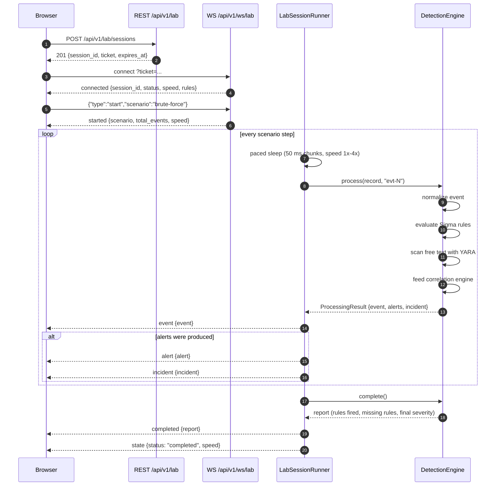

# Lab WebSocket Protocol

The interactive detection lab (mini-SOC simulation) runs over a single
WebSocket. Source of truth: `backend/app/api/v1/ws_lab.py`.

## Contents

- [Endpoint and handshake](#endpoint-and-handshake)
- [Limits and constants](#limits-and-constants)
- [Close codes](#close-codes)
- [Client → server messages](#client--server-messages)
- [Server → client messages](#server--client-messages)
- [Server errors](#server-errors)
- [Heartbeat](#heartbeat)
- [Pacing, speed and backpressure](#pacing-speed-and-backpressure)
- [Detection cycle sequence](#detection-cycle-sequence)

## Endpoint and handshake

```
GET /api/v1/ws/lab/{session_id}?ticket=<ticket>
```

(FastAPI upgrade; the router is mounted with the `/api/v1` prefix in
`backend/main.py:196`.) Local URL: `ws://localhost:8000/api/v1/ws/lab/<session_id>?ticket=<ticket>`.

1. **Create a ticket** — `POST /api/v1/lab/sessions` (rate limited to 10
   requests per IP per 600 s) returns `201`:

   ```json
   {
     "session_id": "sess-0f3ab19c77d2",
     "ticket": "tk-9a41c0b7e2d5f8a3",
     "expires_at": "2026-10-11T14:30:00Z"
   }
   ```

   `session_id` is `sess-` + 12 hex chars, `ticket` is `tk-` + 16 hex chars,
   TTL is `SESSION_TTL_MINUTES = 30` minutes.

2. **Connect with the ticket as a query parameter.** There is **no**
   subprotocol negotiation (`Sec-WebSocket-Protocol` is not used), no
   `Authorization` header and no JWT — the ticket is the only credential.
   A missing `ticket` parameter fails query validation before the socket is
   accepted (test expectation: close code `1008`).

   Note: only the **ticket** is looked up in the `lab_sessions` table. The
   `{session_id}` in the path is a label echoed back in `connected` and is
   never compared with the database — it only has to be ASCII and ≤ 64 chars.

3. **Pre-accept checks** (each one closes the socket immediately):

   | Check | Close code | Reason text |
   | --- | --- | --- |
   | `session_id` longer than 64 chars or non-ASCII | `1008` | `Invalid session id` |
   | 3 or more active connections from the same client IP | `1013` | `Too many connections` |
   | 20 or more active connections globally | `1013` | `Server busy` |
   | Ticket not found / not `active` | `1008` | `Invalid or expired ticket` |
   | Ticket `expires_at` in the past | `1008` | `Expired ticket` |

4. **After `accept()`** the server immediately sends `connected` with the rule
   catalog, the current state and the server clock:

   ```json
   {
     "type": "connected",
     "session_id": "sess-0f3ab19c77d2",
     "status": "idle",
     "speed": 2,
     "speed_options": [1, 2, 4],
     "rules": [{ "id": "bs-auth-failed-logons", "title": "Repeated Failed Logons for One Account", "level": "medium", "kind": "sigma", "mitre": ["T1110.001"], "description": "...", "false_positives": ["..."], "response": ["..."] }],
     "server_time": "2026-10-11T14:00:00Z"
   }
   ```

   Session statuses: `idle | running | paused | completed`.

## Limits and constants

| Constant | Value | Meaning |
| --- | --- | --- |
| `MAX_CONNECTIONS_PER_IP` | `3` | concurrent sockets per client IP |
| `MAX_ACTIVE_SESSIONS` | `20` | concurrent sockets globally |
| `SESSION_MAX_SECONDS` | `1800` (30 min) | playback deadline |
| `PING_INTERVAL_SECONDS` | `30.0` | server heartbeat interval |
| `MAX_MESSAGE_BYTES` | `4096` | inbound frame size cap |
| `CHUNK_SECONDS` | `0.05` (50 ms) | pacing granularity |
| `SPEED_OPTIONS` | `(1, 2, 4)` | values offered to the UI |
| `DEFAULT_SPEED` / `MIN_SPEED` / `MAX_SPEED` | `2` / `1` / `4` | speed clamping |

Session deadline: on accept it is
`min(SESSION_MAX_SECONDS, remaining ticket time)`; a `start` or `restart`
message resets it to a fresh `SESSION_MAX_SECONDS` (1800 s).

## Close codes

| Code | Reason | Trigger |
| --- | --- | --- |
| `1008` | `Invalid session id` | non-ASCII or > 64 char `session_id` |
| `1008` | `Invalid or expired ticket` / `Expired ticket` | ticket lookup failed or past `expires_at` |
| `1008` | `Session expired` | playback deadline reached (preceded by an `error` frame with code `SESSION_EXPIRED`) |
| `1013` | `Too many connections` | per-IP cap (3) reached |
| `1013` | `Server busy` | global cap (20) reached |
| `1011` | `Internal error` | unhandled exception inside the receive loop |

A missing `ticket` query parameter is rejected during the handshake (close
code `1008` per `backend/tests/integration/test_ws_lab.py`).

## Client → server messages

JSON objects with a `type` discriminator. Anything else is answered with an
`error` frame; the socket stays open.

| `type` | Payload | Effect |
| --- | --- | --- |
| `start` | `{"scenario": "<id>", "speed": 2?}` | Begin replay. Rejected with `ALREADY_STARTED` if the session is `running`/`paused` (unless it is a `restart`) |
| `restart` | `{"scenario": "<id>"?, "speed": 2?}` | Reset and replay from the beginning |
| `pause` | `{}` | Only valid while `running`; otherwise `NOT_RUNNING` |
| `resume` | `{}` | Only valid while `paused`; otherwise `NOT_PAUSED` |
| `speed` | `{"value": 4}` | Clamped to 1–4; the current `state` is then echoed back |
| `reload_rules` | `{}` | Hot-reload rules from disk; answers with `rules` |
| `pong` | `{}` | Heartbeat reply — a no-op on the server |

Valid scenario ids: `brute-force`, `after-hours-login`, `temp-process`,
`log-clearing`, `sqli-web`. An unknown id answers
`error UNKNOWN_SCENARIO`.

Inbound framing rules: the frame must be ≤ `4096` UTF-8 bytes, must parse as
JSON and must be a JSON **object** — otherwise the server answers
`error BAD_MESSAGE` (`message too large` / `invalid JSON` /
`expected a JSON object`) and keeps the connection open.

## Server → client messages

| `type` | Payload |
| --- | --- |
| `connected` | `session_id`, `status`, `speed`, `speed_options`, `rules`, `server_time` |
| `started` | `scenario` (`id`, `name`, `description`, `event_count`, `expected_rules`, `expected_severity`, `mitre`), `total_events`, `speed`, `status` |
| `event` | `event` — normalized event: `id`, `timestamp`, `host`, `user`, `process`, `command_line`, `ip`, `category`, `action`, `event_id`, `product`, `hour`, `fields`, `text`, `raw` |
| `alert` | `alert` — `id`, `kind` (`sigma`/`yara`/`correlation`), `rule_id`, `title`, `description`, `severity`, `severity_label`, `mitre`, `timestamp`, `host`, `user`, `event_id`, `count`, `matched_fields`, `false_positives`, `response` |
| `incident` | `incident` — `id`, `title`, `description`, `scenario_id`, `scenario_name`, `opened_at`, `opened_by`, `severity`, `severity_label`, `status`, `alert_ids`, `timeline`, `mitre`, `response`, `false_positives`, `expected_rules`, `expected_severity` |
| `state` | `status`, `speed` |
| `rules` | `rules` (catalog), `errors` (last reload problems, max 5) |
| `completed` | `report` — `scenario_id`, `scenario_name`, `events`, `alerts`, `suppressed`, `correlation_fires`, `rules_fired`, `expected_rules`, `missing_rules`, `unexpected_rules`, `final_severity`, `expected_severity`, `incident`, `yara_engine`, `rule_ms`, `slow_evaluations`, `max_process_ms` |
| `error` | `code`, `message` |
| `ping` | — (heartbeat) |

## Server errors

| `code` | Cause |
| --- | --- |
| `BAD_MESSAGE` | frame > 4096 bytes, invalid JSON, non-object, unknown `type` |
| `ALREADY_STARTED` | `start` while `running`/`paused` |
| `UNKNOWN_SCENARIO` | scenario id not found |
| `NOT_RUNNING` | `pause` while not `running` |
| `NOT_PAUSED` | `resume` while not `paused` |
| `RUNTIME_ERROR` | unhandled exception during playback (session returns to `idle`) |
| `SESSION_EXPIRED` | playback deadline reached; socket then closes with `1008` |

## Heartbeat

- The server sends `{"type": "ping"}` every **30 seconds**
  (`PING_INTERVAL_SECONDS = 30.0`) from a background task.
- The client should reply `{"type": "pong"}`; the server accepts it as a
  no-op. There is no timeout that closes the socket when pongs stop
  arriving — the heartbeat task only stops sending if the socket write fails.
- The heartbeat task and the playback task are cancelled in the `finally`
  block when the socket closes.

## Pacing, speed and backpressure

- Playback sleeps in **50 ms chunks** (`CHUNK_SECONDS = 0.05`), dividing the
  remaining simulated delay by the current `speed`, so `pause`, `speed` and
  the session deadline take effect within 50 ms even during a long gap.
- **Inbound backpressure** is the `MAX_MESSAGE_BYTES = 4096` cap; offending
  frames are rejected with an `error` frame and never close the socket.
- **Outbound**: there is no queue bound or drop policy — each
  `send_json()` is awaited in order by the playback task, so a client that
  stops reading simply throttles that session's loop. Failures during
  error reporting are swallowed (`suppress(Exception)`); an exception in the
  receive loop closes the socket with `1011`.
- Connection bookkeeping is decremented in the `finally` block, and the
  per-IP counter entry is deleted when it reaches zero.

## Detection cycle sequence

One scenario step flowing through the pipeline
(`LabSessionRunner._play` → `DetectionEngine.process`):



Notes on the pipeline (`backend/app/detection/engine.py:292-381`):

- Sigma matches, YARA hits and correlation results are all emitted as alerts;
  duplicates of the same `(rule, host, user)` inside a 120 s simulated window
  are folded into the first alert (`DEDUP_TTL_SECONDS = 120.0`).
- An incident is opened by correlation alerts or any alert at/above `high`
  (`INCIDENT_THRESHOLD = "high"`) and is appended to the incident timeline as
  alerts arrive; `complete()` closes it with an `incident_closed` entry.
- `incident` frames are sent alongside `alert` frames only when the engine
  already holds an incident snapshot for that step.
