# Data Model

Source of truth: the SQLAlchemy 2.0 models under `backend/app/models/`
(registered on the shared `Base` from `backend/app/database/base.py` via
`backend/app/database/session.py`). This document reflects the code exactly —
table and column names, types, nullability and defaults match the models.

## Schema provisioning

| Mechanism | Status in this repo |
|-----------|---------------------|
| `Base.metadata.create_all` | **Active.** `init_db()` runs it once at app startup and logs a warning (not an error) if PostgreSQL is unreachable at that moment (`backend/app/database/session.py:41-51`). |
| Alembic | **Configured but empty.** `backend/alembic/env.py` is a fully wired async environment (imports all four models for `autogenerate`, reads `DATABASE_URL` / `POSTGRES_*`), but there is no `versions/` directory and no revision files, so no migration-defined indexes, constraints or alterations exist. All constraints below come from the model definitions only. |

## Entity-relationship diagram

No `ForeignKey` objects exist in any model: references between entities
(e.g. `audit_log.user_id` → `admin_users.id`) are plain integers with **no
referential integrity enforced by the database**. For that reason the diagram
shows no relationship edges; logical references are called out per entity
below.

```mermaid
erDiagram
    admin_users {
        int id PK "primary key, index=True"
        varchar(128) username "UNIQUE, NOT NULL, index=True"
        varchar(254) email "UNIQUE, NOT NULL"
        varchar(255) hashed_password "NOT NULL"
        boolean is_active "nullable, default true"
        boolean is_superuser "nullable, default false"
        timestamptz last_login "nullable"
        timestamp created_at "NOT NULL, server_default now()"
        timestamp updated_at "NOT NULL, server_default now(), onupdate now()"
    }

    audit_log {
        int id PK "primary key, index=True"
        varchar(255) action "NOT NULL"
        varchar(100) resource_type "nullable"
        int resource_id "nullable"
        int user_id "nullable, logical ref to admin_users.id (no FK)"
        varchar(45) ip_address "nullable"
        text details "nullable"
        timestamp created_at "NOT NULL, server_default now()"
    }

    contact_messages {
        int id PK "primary key, index=True"
        varchar(255) name "NOT NULL"
        varchar(255) email "NOT NULL"
        varchar(255) subject "nullable"
        text message "NOT NULL"
        varchar(255) honeypot "nullable, default ''"
        varchar(50) status "nullable, default 'new'"
        boolean read "nullable, default false"
        timestamp created_at "NOT NULL, server_default now()"
        timestamp updated_at "NOT NULL, server_default now(), onupdate now()"
    }

    lab_sessions {
        int id PK "primary key, index=True"
        varchar(128) session_token "UNIQUE, NOT NULL, index=True"
        varchar(45) ip_address "NOT NULL"
        text user_agent "nullable (never populated by current code)"
        varchar(50) status "nullable, default 'active'"
        timestamptz expires_at "NOT NULL"
        timestamp created_at "NOT NULL, server_default now()"
    }
```

`timestamp` columns backed by `server_default=func.now()` are naive
`timestamp without time zone`; columns declared `DateTime(timezone=True)` are
`timestamptz`. The cleanup worker relies on this distinction
(`backend/app/workers/cleanup/old_events_cleanup.py:38-49`).

## Entities

### `admin_users` — `backend/app/models/admin_user.py`

Purpose: credentials for the JWT-protected admin area. Looked up during
login (`backend/app/api/v1/auth.py:46`) and on every authenticated request
(`backend/app/core/deps.py:38-41`). `hashed_password` is a password hash
(never plaintext); `is_superuser` gates admin-only routes via
`require_admin`.

| Property | Detail |
|----------|--------|
| Retention | **None configured.** Not touched by any cleanup worker. |
| Indexes / constraints | `id` PK + index; `username` UNIQUE + index; `email` UNIQUE. |
| Notes | `is_active` / `is_superuser` are nullable with Python-side defaults; deactivating a user is done by setting `is_active` false. |

### `audit_log` — `backend/app/models/audit_log.py`

Purpose: intended audit trail (`action`, `resource_type`/`resource_id`,
`user_id`, `ip_address`, `details`). It is registered for Alembic
autogenerate (`backend/alembic/env.py:30-35`), but **no code currently
inserts rows** — the only reference to the class in the backend is its own
definition.

| Property | Detail |
|----------|--------|
| Retention | **None configured.** |
| Indexes / constraints | `id` PK + index only. No index on `action`, `user_id` or `created_at`. |
| Notes | `user_id` and `resource_id` are plain integers — no FK to `admin_users` or any other table. `ip_address` is `varchar(45)` (IPv6-sized) and nullable. |

### `contact_messages` — `backend/app/models/contact_message.py`

Purpose: storage for contact-form submissions, deliberately minimal personal
data (name, email, subject, message) per the LGPD note in the docstring — no
IP, user-agent or fingerprint is ever written. Written by
`ContactService.submit` (`backend/app/services/contact_service.py:70-84`),
read/listed and marked read through the admin API.

| Property | Detail |
|----------|--------|
| Retention | **90 days** default: `CONTACT_RETENTION_DAYS` (`backend/app/core/config.py:63`). `cleanup_expired_contact_messages` deletes rows with `created_at < now - retention` (naive UTC cutoff). Runs every `CLEANUP_INTERVAL_HOURS` (24 h default) from the lifespan loop (`backend/main.py:78-92`) and on demand via `run_retention_cleanup`. |
| Indexes / constraints | `id` PK + index only. **No index on `email` or `created_at`**, although both are filtered by the per-email rate limit (`email` + `created_at >= now-1h`) and by the retention delete. |
| Defaults | `honeypot=""`, `status="new"`, `read=False` (Python-side defaults). |
| Notes | `subject` is nullable in the model even though the API schema requires it. On mark-read, `updated_at` is set explicitly in the UPDATE. |

### `lab_sessions` — `backend/app/models/lab_session.py`

Purpose: ephemeral ticket store for the detection-lab WebSocket. Created by
`LabService.create_session` (`backend/app/services/lab_service.py:110-117`)
with a `tk-…` token and a 30-minute deadline (`SESSION_TTL_MINUTES`); the WS
route validates ticket + status + expiry on every connect
(`backend/app/api/v1/ws_lab.py:312-325`). Lab events and alerts themselves
are **never persisted** — they live only in the session's in-memory
`DetectionEngine` and in the browser.

| Property | Detail |
|----------|--------|
| Retention | **30 days** default: `LAB_SESSION_RETENTION_DAYS` (`backend/app/core/config.py:64`). `cleanup_expired_lab_sessions` deletes rows with `expires_at < now - retention` (aware `timestamptz` cutoff), same 24 h loop as above. |
| Indexes / constraints | `id` PK + index; `session_token` UNIQUE + index. |
| Defaults | `status="active"` (Python-side). |
| Notes | `user_agent` is nullable and never populated by current code; `ip_address` is NOT NULL (used only for in-memory rate limiting and salted-hash logging, not for abuse of the value). Session lifetime is minutes; the 30-day retention is for the row, not for a live session. |

## Retention summary

| Data | Setting (env) | Default | Cleanup code |
|------|---------------|---------|--------------|
| `contact_messages` | `CONTACT_RETENTION_DAYS` | 90 days | `backend/app/workers/cleanup/old_events_cleanup.py:52-68` |
| `lab_sessions` | `LAB_SESSION_RETENTION_DAYS` | 30 days | `backend/app/workers/cleanup/old_events_cleanup.py:71-85` |
| `admin_users`, `audit_log` | — | retained indefinitely | — |
| Log files | `LOG_MAX_AGE_DAYS` / `LOG_KEEP_FILES` / `LOG_MAX_BYTES` | 14 days / 5 files / 10 MiB | config only (`backend/app/core/config.py:68-70`); `backend/app/workers/cleanup/log_cleanup.py` is an empty stub |
| Temp files | `TEMP_RETENTION_HOURS` | 24 h | config only; `backend/app/workers/cleanup/temp_cleanup.py` is an empty stub |
| Redis (cache, rate-limit ZSETs, queues) | — | ephemeral | Redis runs with `--save "" --appendonly no` (`docker-compose.yml:36`); all keys evaporate on restart and are reconstructible by design (ADR 002). |

## Indexes and constraints (complete list)

Everything the database enforces today, since Alembic has no revisions:

| Table | Constraint / index | Source |
|-------|--------------------|--------|
| `admin_users` | PK `id`; unique `username`; unique `email`; index on `username`; extra index on `id` (`index=True` on the PK column) | `admin_user.py:13-15` |
| `audit_log` | PK `id` + index on `id` | `audit_log.py:13` |
| `contact_messages` | PK `id` + index on `id` | `contact_message.py:20` |
| `lab_sessions` | PK `id` + index on `id`; unique + index on `session_token` | `lab_session.py:12-13` |

There are **no** foreign keys, check constraints, partial/expression indexes
or exclusion constraints anywhere in the model layer.

## State that is *not* in PostgreSQL

| Store | Contents | Lifetime |
|-------|----------|----------|
| Redis | Sliding-window rate-limit ZSETs (`bluesentinel:ratelimit:…`), GitHub stats cache (TTL 1 h + stale mirror), email queue primitives (`queue:email`, `:delayed`, `:dead`) | Ephemeral (no persistence) |
| Backend process memory | Lab sessions' detection state (alerts, incidents, dedup map), lab session-creation rate buckets, Prometheus counters/histograms, alert dedup timestamps, security-event ring buffer with rotating salt | Process lifetime |
| Browser | Lab timeline, alerts, incident rendering | Client session |
