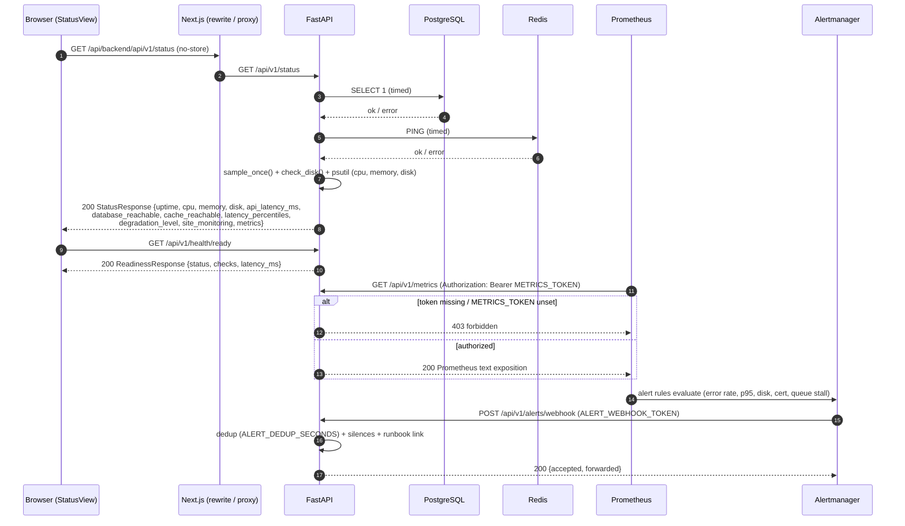
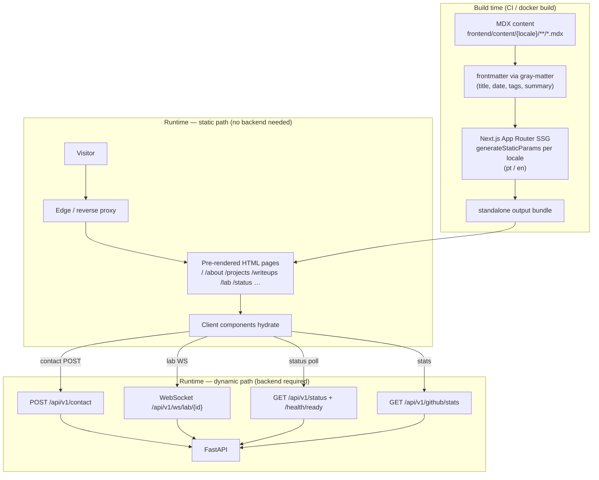

```mermaid
sequenceDiagram
    autonumber
    participant B as Browser (ContactForm, client component)
    participant N as Next.js server (rewrite/proxy)
    participant A as FastAPI POST /api/v1/contact
    participant R as Redis (sliding-window limiter)
    participant D as PostgreSQL (contact_messages)
    participant W as FastAPI BackgroundTasks (in-process)
    participant P as Email provider (SMTP via aiosmtplib)

    B->>N: POST /api/backend/api/v1/contact (JSON)
    N->>A: forwarded to /api/v1/contact
    Note over A: Pydantic validation of ContactRequest<br/>name 1-255, EmailStr, subject 1-255,<br/>message 1-5000, honeypot empty
    alt invalid payload
        A-->>B: 422 VALIDATION_ERROR (application/problem+json)
    end
    A->>R: EVAL Lua sliding window key contact-ip:{ip} (10 req / 60 s)
    alt over limit
        R-->>A: deny
        A-->>B: 429 RATE_LIMIT + Retry-After header
    else allowed (or Redis unavailable, see failure modes)
        R-->>A: allow + remaining
        A->>A: honeypot non-empty? return 202 status=ignored, no DB write
        A->>D: SELECT COUNT(*) WHERE email=? AND created_at >= now-1h
        alt 5 or more messages this hour for this email
            D-->>A: count >= 5
            A-->>B: 429 RATE_LIMIT + Retry-After: 3600
        else under per-email limit
            D-->>A: count < 5
            A->>D: INSERT contact_messages (status='new', read=false) + COMMIT
            D-->>A: row id
            A-->>B: 202 ContactAccepted {id, status: "queued", request_id}
            A->>W: background task: EmailService.send_contact_notification
            W->>P: aiosmtplib.send (TLS on 465, STARTTLS on 587/25)
            alt SMTP_HOST unset
                W->>W: log email instead (console provider)
            end
            P-->>W: ok / exception (logged, returns False)
        end
    end
```

# Runtime Flows

Companion to [overview.md](./overview.md). This document describes the main
runtime flows as implemented in the codebase, with GitHub-compatible Mermaid
diagrams and explicit failure modes. Sources are referenced inline as
`path:line` so each step can be verified against the code.

---

## 1. Contact Form Submission

**Code path:** `frontend/src/components/contact/contact-form.tsx` →
Next.js rewrite (`frontend/next.config.js:29-44`) →
`backend/app/api/v1/contact.py` → `backend/app/services/contact_service.py`
→ `backend/app/services/email_service.py`.

The browser posts a same-origin request to
`/api/backend/api/v1/contact` (`contact-form.tsx:82`). In development the
Next.js server rewrites it to `BACKEND_INTERNAL_URL/api/v1/contact`; in
production the reverse proxy forwards `/api/v1/*` straight to FastAPI
(comment in `next.config.js:31-33`).

### Sequence



### Step details

| Step | Behavior | Source |
|------|----------|--------|
| Validation | `ContactRequest` (name 1–255, `EmailStr`, subject 1–255, message 1–5000, honeypot max 255). Failures become `422` problem+json via the global `RequestValidationError` handler. | `backend/app/schemas/contact.py`, `backend/main.py:141-153` |
| IP rate limit | Sliding window in a Redis ZSET, executed atomically by one Lua `EVAL`. Limit **10 requests / 60 s** per client IP, key `bluesentinel:ratelimit:contact-ip:{ip}:60:10`. | `backend/app/api/v1/contact.py:21-29`, `backend/app/middleware/rate_limit.py` |
| Honeypot | Non-empty honeypot → silently accept (`202`, `status="ignored"`, `id=0`) without any DB insert; logs only a salted IP hash. | `backend/app/services/contact_service.py:48-55` |
| Per-email limit | **5 messages / hour / email**, counted in the database — last line of defense independent of Redis. | `backend/app/services/contact_service.py:17,57-68` |
| Persistence | Insert minimal row (name, email, subject, message, `status="new"`, `read=False`). No IP or user-agent is stored (LGPD). | `backend/app/models/contact_message.py`, `contact_service.py:70-84` |
| Response | `202 Accepted` with `{id, status:"queued", request_id}` — returns before email delivery. | `contact.py:32-41,89` |
| Email delivery | `BackgroundTasks` runs `EmailService.send_contact_notification` in the API process. `SMTP_HOST` empty → log-only "console" provider; TLS only on port 465, STARTTLS on 587/25. Failures are logged and swallowed (`return False`). | `backend/app/services/email_service.py`, `contact.py:79-87` |

> **Note on the Redis queue design.** `backend/app/workers/background_jobs.py`
> implements a full queue pipeline (`queue:email` LIST, `queue:email:delayed`
> ZSET for retries, `queue:email:dead` DLQ, backpressure via
> `EMAIL_QUEUE_MAX_LEN` default 500, `EMAIL_MAX_ATTEMPTS` default 5,
> exponential backoff with jitter from `EMAIL_RETRY_BASE_SECONDS`).
> In the current wiring the contact endpoint delivers via in-process
> `BackgroundTasks`; `enqueue_email` is not called from any endpoint, and the
> compose `worker` service runs `python -m app.workers.event_worker`
> (`docker-compose.yml:111-115`), which is currently an empty module. The
> queue primitives are ready for a dedicated consumer but are not on the
> live path today.

### Failure modes

| Failure | Behavior |
|---------|----------|
| **Redis down** (limiter) | The Lua `EVAL` raises; the limiter applies `RATE_LIMIT_FAIL_CLOSED` (`backend/app/core/config.py:21`, default `false` → **fail-open**: request allowed, availability wins). With `RATE_LIMIT_FAIL_CLOSED=true` → **fail-closed**: every limited request gets `429` with `Retry-After` equal to the window. The per-email DB limit (5/h) still applies in both cases. Rate limiting is abuse control, not access control (rationale in `rate_limit.py:1-12`). |
| **Redis down** (queue) | `enqueue_job` catches exceptions, logs a warning, returns `False`; the form response is unaffected because persistence already happened. |
| **PostgreSQL down** | Session creation (`count` or `INSERT`) raises → caught by the generic exception handler → `500 INTERNAL_ERROR` problem+json with no stack traces (`backend/main.py:181-188`). Nothing is persisted; the message is lost from the visitor's perspective. Static pages keep working. |
| **Provider (SMTP) down** | The message is already stored (`contact_messages`); the background task logs `Email send failed` and returns `False`. There is no retry on this path — retrieval is via the admin list endpoint. On startup, if the DB is unreachable, `init_db()` only logs a warning (`backend/app/database/session.py:41-51`). |

---

## 2. Interactive Detection Lab (`/lab`)

**Code path:** `frontend/src/app/[locale]/lab/page.tsx` →
`frontend/src/components/lab/use-lab-session.ts` →
`backend/app/api/v1/lab.py` (REST) + `backend/app/api/v1/ws_lab.py`
(WebSocket) → `backend/app/services/lab_service.py` →
`backend/app/collectors/scenario_generator.py` →
`backend/app/detection/engine.py` (Sigma + YARA + correlation).

All events are synthetic and defensive-only: documentation IP ranges
(RFC 5737 / RFC 3927), demo hostnames and placeholder users
(`backend/app/collectors/scenario_generator.py:1-14`). Nothing is collected
from real telemetry.

### Sequence

```mermaid
sequenceDiagram
    autonumber
    participant B as Browser (Lab UI, client component)
    participant A as FastAPI
    participant D as PostgreSQL (lab_sessions)
    participant G as Scenario generator (synthetic events)
    participant E as DetectionEngine (Sigma + YARA + correlation)

    B->>A: POST /api/v1/lab/sessions
    A->>A: in-memory per-IP limit (10 / 600 s)
    A->>D: INSERT lab_sessions (session_token, ip_address, status='active', expires_at = now+30 min)
    D-->>A: ok
    A-->>B: 201 {session_id: "sess-…", ticket: "tk-…", expires_at}

    B->>A: WebSocket /api/v1/ws/lab/{session_id}?ticket=…
    A->>A: caps check (max 3 conns/IP, max 20 active)
    A->>D: SELECT lab_sessions WHERE session_token=? AND status='active' AND expires_at > now
    D-->>A: session row
    A-->>B: accept + "connected" {session_id, speed_options, rule catalog}
    B->>A: {"type":"start","scenario":"…","speed":2}
    A->>E: DetectionEngine(rules_dir, scenario) — per-session instance
    A-->>B: "started" {scenario, total_events, speed}

    loop each ScenarioStep (paced at 50 ms chunks, speed 1x/2x/4x)
        G->>E: synthetic record (auth/process/network/file)
        E->>E: hot-reload rules if files changed
        E->>E: normalize event
        E->>E: Sigma rules (per-rule timed match)
        E->>E: YARA scan of free-text field
        E->>E: correlation engine (windowed stages on simulated clock)
        E->>E: dedup (rule, host, user) inside 120 s simulated window
        E-->>A: ProcessingResult {event, alerts, incident?}
        A-->>B: "event" {event}
        A-->>B: "alert" {alert} (0..n per event)
        A-->>B: "incident" {incident} (correlation or severity >= high)
    end

    A-->>B: "completed" {report: rules fired vs expected, severity, latency stats}
    A-->>B: "state" {status: completed}
    Note over A,B: heartbeat "ping"/"pong" every 30 s; session deadline 30 min
```

### Step details

| Step | Behavior | Source |
|------|----------|--------|
| Session create | `POST /api/v1/lab/sessions` — in-memory sliding window of 10 creations / 600 s per IP; inserts `lab_sessions` with a `tk-…` ticket, `status="active"`, `expires_at` now + `SESSION_TTL_MINUTES` (30). `user_agent` is never populated. | `backend/app/services/lab_service.py:33-36,100-126` |
| WS connect | Path `/api/v1/ws/lab/{session_id}?ticket=…`. Rejects non-ASCII/long ids, >3 connections per IP, >20 global sessions; ticket must match an active, unexpired row or the socket closes with code 1008. | `backend/app/api/v1/ws_lab.py:293-328` |
| Rule catalog | The `connected` message carries Sigma/YARA/correlation summaries from a shared, hot-reloading `DetectionEngine` used only as a catalog; each session owns its own engine instance. | `lab_service.py:54-69`, `ws_lab.py:106-117` |
| Playback | `start` resolves the scenario and spawns an asyncio task. Each step waits while paused, sleeps in 50 ms chunks divided by the current speed, then calls `engine.process(record, "evt-N")`. | `ws_lab.py:222-273` |
| Detection pipeline | Per event: hot-reload check → `normalize` → Sigma evaluation per rule (timed, slow-eval accounting) → one YARA scan over the free-text field → correlation feed (windowed stages; consumes even dedup-suppressed matches) → alert emission with simulated-clock de-duplication (`DEDUP_TTL_SECONDS = 120` per rule/host/user). | `backend/app/detection/engine.py:292-434` |
| Incident | A correlation alert or any alert at/above `high` opens one incident with a didactic timeline; further alerts append to it; `complete()` closes it and builds the final report (expected vs fired rules, missing/unexpected, max process ms). | `engine.py:456-576` |
| UI timeline | The browser renders the streamed `event` / `alert` / `incident` messages in the SOC-style panels (`alerts-panel.tsx`, `incident-timeline.tsx`). Event/alert data is **not** persisted — only the `lab_sessions` row reaches PostgreSQL. | `frontend/src/components/lab/*` |
| Hot reload | `reload_if_changed` runs on every event and on the `reload_rules` message; a bad edit is collected in `stats["reload_errors"]` and never kills the session. | `engine.py:274-288`, `ws_lab.py:156-173` |

### Failure modes

| Failure | Behavior |
|---------|----------|
| **PostgreSQL down at session create** | `POST /lab/sessions` raises → `500 INTERNAL_ERROR`; no ticket is issued. |
| **PostgreSQL down at WS connect** | The ticket lookup raises inside the WebSocket route before `accept()`; no session starts. Static site and other flows are unaffected. |
| **Redis down** | Lab playback does not use Redis; sessions and rate limits are in-memory. The lab keeps working (the site-wide GitHub cache and contact limiter are the degraded parts). |
| **Server overload** | Connection caps (3/IP, 20 global) close sockets with code 1013; resource monitoring can raise the degradation level and, with `LAB_DEGRADE_ENABLED=true` (default), the lab is the first feature shed under pressure (`backend/app/core/config.py:80-81`). |
| **Session deadline / expiry** | 30-minute deadline (bounded by ticket expiry) raises `_SessionExpired` → `error SESSION_EXPIRED` and close 1008. |
| **Playback bug** | Caught per session: `error RUNTIME_ERROR`, status returns to `idle`; the socket stays open for a restart. |
| **Rule file corruption** | Reload errors are listed in the `rules` message; the last good rule set stays active. |

---

## 3. Status & Metrics Snapshot

**Code path:** `frontend/src/components/status/status-view.tsx` (client
component, polls with `cache: 'no-store'`) →
`backend/app/api/v1/status.py`, `health.py`, `metrics.py`, plus background
sampler/alert loops started in the app lifespan (`backend/main.py:95-112`).

### Sequence



### Step details

| Endpoint | Behavior | Source |
|----------|----------|--------|
| `GET /api/v1/status` | `SELECT 1` latency → `api_latency_ms` + `database_reachable`; Redis `PING` → `cache_reachable`; cheap synchronous psutil sample (`sample_once`) so gauges never freeze; disk via `check_disk`; in-process latency percentiles; degradation level; "site monitoring" recent security events (salted hashes, rotating salt). Never exposes internals or PII. | `backend/app/api/v1/status.py:25-84` |
| `GET /api/v1/health/live` | Liveness only — process is up; no dependencies. | `backend/app/api/v1/health.py:10-13` |
| `GET /api/v1/health/ready` | Readiness: PostgreSQL + cache + disk checks with total latency; used by the Docker healthcheck (`docker-compose.yml:75-79`). | `health.py:16-20` |
| `GET /api/v1/metrics` | Prometheus exposition, always token-protected: empty `METRICS_TOKEN` → endpoint disabled (403); constant-time comparison; `Cache-Control: no-store`. | `backend/app/api/v1/metrics.py` |
| Alert webhook | `POST /api/v1/alerts/webhook` receives Alertmanager payloads (constant-time token check, 403 otherwise), re-applies dedup/silences, appends the runbook link and forwards to webhook (Discord/Telegram) and/or email. | `backend/app/api/v1/alerts.py`, `backend/app/monitoring/alerts.py` |
| Background loops | Lifespan starts the resource monitor (15 s sampling), the alert self-check monitor (60 s) and the LGPD retention loop (24 h). | `backend/main.py:95-112`, `backend/app/core/config.py:72-120` |

### Failure modes

| Failure | Behavior |
|---------|----------|
| **PostgreSQL down** | `status` still returns `200` with `database_reachable: false` (degraded, not an error). `/health/ready` reports the failing check; the Docker healthcheck flips, which prevents the worker service from starting (`depends_on: backend: service_healthy`). |
| **Redis down** | `status` reports `cache_reachable: false`. GitHub stats fall back to the stale mirror in `CacheManager` or to empty stats. Contact rate limiting follows `RATE_LIMIT_FAIL_CLOSED` (see flow 1). |
| **High resource usage** | CPU/memory/disk thresholds raise `degradation_level`; alerts fire through the notifier with dedup and silence support. |

---

## 4. Static Page Rendering vs Dynamic API Path

**Static-first by design** (overview principle): core pages are pre-rendered
HTML and work with the backend fully offline; only the contact form, lab,
status dashboard and GitHub counters need the API.

### Rendering path



| Aspect | Static path | Dynamic path |
|--------|-------------|--------------|
| Content source | MDX files in the repo (ADR 001: `docs/architecture/adr/001-content-in-mdx.md`) | FastAPI under `/api/v1/*` |
| Generation | SSG at build: `generateStaticParams` enumerates locales and slugs (`frontend/src/lib/writeups.ts:55-57`, `projects.ts`, layout locale params). No `revalidate` export exists in the codebase, so pages are pure build-time static — content changes ship with a rebuild, per ADR 001. | Runtime REST/WebSocket, per flows 1–3. |
| Transport | Plain HTML/JS from the frontend container (port 3000). | Same-origin `/api/v1/*` (and `/api/backend/*`): rewritten to `BACKEND_INTERNAL_URL` server-side in dev; the reverse proxy sends `/api/v1/*` directly to the backend in production (`next.config.js:29-44`). |
| Backend dependency | **None** — the site remains fully usable if FastAPI, PostgreSQL and Redis are down (contact/lab/status widgets degrade gracefully). | Backend on `backend-net`; PostgreSQL and Redis are never exposed outside the internal network (`docker-compose.yml:156-162`). |
| Failure isolation | A build failure blocks publishing; a runtime backend outage does not affect already-served pages. | Each client component handles fetch failures locally (e.g. status probes resolve to `null` and the UI shows degraded state). |

---

## Cross-cutting failure matrix

| Dependency | Contact | Lab | Status | GitHub stats | Static pages |
|------------|---------|-----|--------|--------------|--------------|
| Redis down | Fail-open by default (`RATE_LIMIT_FAIL_CLOSED=false`); fail-closed blocks with 429 when enabled. Per-email DB limit still applies. | Unaffected (in-memory limits). | `cache_reachable: false`. | Stale cache mirror, else empty stats. | Unaffected. |
| PostgreSQL down | 500 on submit; nothing persisted. | No ticket → no WS session. | `database_reachable: false`, endpoint still 200. | Unaffected (cache-only). | Unaffected. |
| SMTP provider down | Message stored; notification lost (logged). No retry on the BackgroundTasks path. | n/a | n/a | n/a | Unaffected. |
| Backend down | Form shows error; page loads. | WS never connects; page loads. | Polls fail; UI shows degraded. | Counters empty/stale. | Fully functional. |
