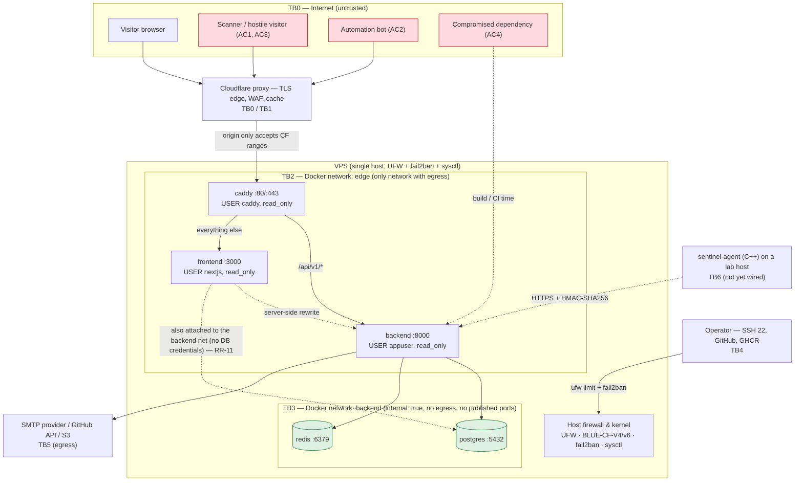

# Threat Model — BLUE-SENTINEL (STRIDE)

Structured threat model for the public site, the FastAPI backend, the
detection lab and the C++ telemetry agent. Every claim below points at the
file that implements (or fails to implement) it; line numbers refer to the
state of the repository when this document was written.

Companion documents — they answer *different* questions and are not repeated
here:

| Question | Document |
|---|---|
| What data do we hold, for how long, how is it deleted? | [`data-inventory.md`](./data-inventory.md) |
| Which adversary techniques can we *detect*? | [`attack-coverage.md`](./attack-coverage.md) |
| How is an alert scored and when does an incident open? | [`severity.md`](./severity.md) |
| How do we tune a noisy rule without breaking it? | [`tuning-guide.md`](./tuning-guide.md) |
| How is it deployed, segmented and backed up? | [`infrastructure.md`](../architecture/infrastructure.md), [`disaster-recovery.md`](../architecture/disaster-recovery.md) |
| Runtime request/WS flows | [`flows.md`](../architecture/flows.md) |

---

## 1. Scope and method

- **Method:** STRIDE, applied per element, starting from assets and organized
  around trust boundaries. Threats are stated as *what an actor wants to do*,
  mitigations as *what already exists in this repo* (with a path), accepted
  risks as *deliberate decisions with a rationale*, residual risks as *what is
  still open*.
- **In scope:** the Internet-facing site (Next.js), the API and lab
  (FastAPI + Redis + PostgreSQL), the edge (Cloudflare + Caddy), the Docker
  host, the CI/registry path, and the standalone C++ agent (`agent/`).
- **Out of scope:** Cloudflare's and S3's internal security, physical
  security, the platform supply chain of GitHub itself, and any adversary
  model that requires beating both Cloudflare and the origin firewall
  *before* an application-layer attack (see accepted risk AR-08).
- **Defensive only.** No exploit, payload or malware sample is shipped; the
  SQLi/traversal strings in `rules/` are *detection patterns* read from log
  lines, never executed (`docs/security/tuning-guide.md:8-9`).

## 2. Elements under review

| # | Element | Tech | Main entry points | Notes |
|---|---|---|---|---|
| E1 | Public site | Next.js standalone (`frontend/`) | `GET /*` via Caddy | Static/ISR pages, contact form, lab UI |
| E2 | Backend API | FastAPI + SQLAlchemy/asyncpg (`backend/`) | `/api/v1/*` via Caddy | Contact, lab, status, health, auth, admin, alert webhook |
| E3 | Detection lab | Session runner + WebSocket (`ws_lab.py`) | `POST /api/v1/lab/sessions`, `WS /api/v1/ws/lab/{id}` | CPU-bound replay, ephemeral tickets |
| E4 | Data stores | PostgreSQL 16, Redis 7 (`docker-compose.prod.yml`) | none from the Internet | Backend network only |
| E5 | Edge / host | Cloudflare, Caddy, UFW, fail2ban, sysctl | 80/443, SSH 22 | Single VPS |
| E6 | C++ agent | C++20 (`agent/`) | `--send` to an HTTPS ingest URL | Read-only telemetry; **no backend ingest route exists today** (§8 AR-04) |
| E7 | Supply chain | GHCR images, pnpm/pip lockfiles, rules | CI/release | `.github/workflows/{ci,release,agent}.yml` |

## 3. Assets

| ID | Asset | Where it lives | Impact if lost/modified/stolen | Primary controls |
|---|---|---|---|---|
| A1 | Contact form PII (name, e-mail, message) | `contact_messages` table (`backend/app/models/contact_message.py:20-29`) | LGPD breach, spam relay, reputational | Columns limited to 4 fields — **no IP/user-agent stored**; log redaction (§7 TR-03); 90-day retention (`config.py:63`) |
| A2 | Lab session records (incl. visitor IP) | `lab_sessions` (`backend/app/models/lab_session.py:13-17`) | IP disclosure, up to 30-day retention | TTL + retention worker (`config.py:64`); hashed IP in logs (`security_events.py:73`) |
| A3 | Admin credentials | `admin_users` (bcrypt hashes), `SECRET_KEY` (JWT) | Full admin API access | bcrypt + HS256 + 1 h TTL (`auth.py:21-32`), `require_admin` (`deps.py:54`) |
| A4 | Server secrets | `./secrets/*` (mode 600, dir 700), `.env.prod` | DB/SMTP/CF/backup compromise | `deploy.sh init` (`deploy.sh:40-63`), Docker secrets + `load-secrets.sh` |
| A5 | Backups | `backups/*.dump.age`, `*.tar.age` → S3 via rclone | Full data + config disclosure | age encryption + external escrow (`disaster-recovery.md:§3`) |
| A6 | Site availability / TLS identity | Caddy ACME account, DNS | Outage, cert misuse | DNS-01 with CF token, `healthcheck.sh` cert gate (`healthcheck.sh:110-120`) |
| A7 | Detection content & lab integrity | `rules/` mounted `:ro` (`docker-compose.prod.yml:260`) | False negatives/positives, cover-up | read-only mount; `validate_rules.py` in CI; fixture hit-rate gate |
| A8 | Alert/notification path | `ALERT_WEBHOOK_TOKEN`, `ALERT_WEBHOOK_URL`, `METRICS_TOKEN` | Alert spoofing, alert flood | constant-time compare, **closed by default** (`alerts.py:56-58`, `api/v1/metrics.py:33-43`) |
| A9 | Agent authenticity | `AGENT_HMAC_SECRET`, `AGENT_API_KEY` | Forged telemetry batches | HMAC-SHA256 + anti-replay window (`agent/README.md:30-32`); server route not implemented (AR-04) |
| A10 | Repo / registry | GitHub, GHCR tags `vX.Y.Z` | Backdoored release | Gated release (`release.yml`: pytest ≥ 85 %, rules, lint/types) |

## 4. Actors

| ID | Actor | Motivation | Capability | Primary vectors | Main defenses |
|---|---|---|---|---|---|
| AC1 | **Script kiddie / opportunistic scanner** | Deface, crypto-mining, quick win | Low; public scanners, off-the-shelf kits (SQLi, traversal, CMS probes) | `/api/v1/*` probes, path traversal, bad User-Agents | Cloudflare WAF + Caddy CF-only origin (`Caddyfile:49,74-76`), parameterised SQL + sort allowlist (`contact_service.py:94-104`), and the site's own 404/401/429 fed to the detection engine — a 20×404 burst triggers `corr-web-scan-404` (`security_events.py:17-20,245-323`, rule `rules/patterns/corr-web-scan-404.yaml`) |
| AC2 | **Automation bot** | Contact-form spam, credential stuffing, resource abuse | Medium; distributed IPs, high request rates | `POST /contact`, `POST /lab/sessions`, WS churn, `POST /auth/login` | Honeypot (`contact_service.py:49-55`), IP 10/min + e-mail 5/h (`contact.py:21-22`, `contact_service.py:17`), lab 10/600 s per IP (`lab_service.py:33-36`), WS 3/IP + 20 global caps (`ws_lab.py:53-54`), Cloudflare rate limiting at the edge |
| AC3 | **Malicious recruiter-visitor** (hostile human on the public site) | Harvest other visitors' data, abuse the lab, pivot to admin, deface | Medium-high; manual testing, crafted payloads, own browser | XSS in contact text, CSRF/HTML injection, admin login brute force, lab DoS, scraping | React output encoding + `X-Content-Type-Options: nosniff` + `Referrer-Policy` (`next.config.js:45-65`), CORS locked to `ALLOWED_HOSTS` in production (`main.py:128-134`), JSON-only API (no reflected HTML), the only cookie is the locale preference (no session cookie ⇒ classic CSRF does not apply, `data-inventory.md:§3`), lab ticket auth + message size cap (`ws_lab.py:62,337-348`), admin login is API-only (no UI route exists under `frontend/src/app`) |
| AC4 | **Compromised dependency / supply chain** | Backdoor the site or exfiltrate build-time secrets | Silent; affects builds, not runtime traffic | malicious `pnpm`/`pip` package, tampered base image, poisoned GHCR tag | `pnpm install --frozen-lockfile` + pip `requirements.txt` in CI (`ci.yml:37,95`), images rebuilt from versioned Dockerfiles and pushed only from `release.yml` on tag `v*`, DR re-pulls by immutable tag (`disaster-recovery.md:§2`), no third-party scripts/pixels on the page (single locale cookie, `data-inventory.md:§3`) |
| AC5 | **Direct-origin attacker** (bypasses Cloudflare) | Hit the origin before/without edge protections | Medium; needs the origin IP | Raw requests to `:80/:443`, host-header attacks | `@cf remote_ip` matcher → 403 (`Caddyfile:49,74-76`) **and** `DOCKER-USER` chain `BLUE-CF-V4/v6` dropping 80/443 from non-CF ranges (`harden-server.sh:84-160`); UFW SSH `limit` (`harden-server.sh:51-53`) |
| AC6 | **Operator error / insider** (single operator) | — (accidental) | High; root on the VPS, repo write | `docker compose down -v`, committing `secrets/`, deleting volumes | Compose header warns against `down -v` (`docker-compose.prod.yml:19`), secrets outside Git with 600/700 (`deploy.sh:63`), pre-restore snapshot (`restore.sh`), `run_retention_cleanup()` on demand, audit trail **not yet written** (RR-06) |

## 5. Trust boundaries



| ID | Crossing | Direction | Enforced by | Failure mode if removed |
|---|---|---|---|---|
| TB0 | Visitor → Cloudflare | untrusted → edge | Cloudflare proxy + WAF, `Full (strict)` TLS (`infrastructure.md:§4`) | Origin IP visible, no edge filtering |
| TB1 | Cloudflare → Caddy | edge → origin | `@cf remote_ip` → 403 (`Caddyfile:49,74-76`) **and** iptables `BLUE-CF-V4/v6` DROP (`harden-server.sh:84-160`) | Origin directly reachable, bypassing WAF/cache |
| TB2 | Caddy → frontend/backend | proxy → app | Docker `edge` network; `X-Forwarded-For` overwritten with `CF-Connecting-IP` (`Caddyfile:60-61,67-68`), uvicorn `--proxy-headers` (`docker-compose.prod.yml:227-228`) | Client can spoof its own IP into the rate limit |
| TB3 | backend → postgres/redis | app → data | `internal: true` network, **no published ports**, `read_only`, `cap_drop: ALL` (`docker-compose.prod.yml:125-132,181-190,266-274`). **Caveat:** `frontend` is also attached to `backend` (`docker-compose.prod.yml:318-320`) so a compromised Next.js process could open sockets to 5432/6379 — it holds no DB credential (env is `TZ/NODE_ENV/TELEMETRY/BACKEND_INTERNAL_URL` only, `:303-307`) → RR-11 | Data stores reachable from the host/Internet; container escape impact grows |
| TB4 | Operator → host/repo | human → control plane | UFW default deny + `limit` on SSH (`harden-server.sh:49-57`), fail2ban `sshd` (`harden-server.sh:184-194`), secrets dir `700` (`deploy.sh:63`) | Host takeover, secret exfiltration |
| TB5 | backend → SMTP/GitHub/S3 | egress | Explicit env/secret config; only containers attached to `edge` have a route out (`backend` is `internal: true`, `infrastructure.md:§1`) | Data exfiltration after compromise |
| TB6 | agent → lab ingest | host → API | Agent-side HTTPS-only + HMAC ±300 s (`agent/README.md:28-32`); **server-side verification absent** (AR-04) | Forged telemetry if/when an ingest route ships |

Dev vs. prod note: the development stack (`docker-compose.yml:156-162`) uses
`frontend-net` / `backend-net` (backend-net already `internal: true`) and
publishes `8000`/`3000` on the host (all interfaces, `docker-compose.yml:73-74,137-138`
— dev convenience, never expose that compose file publicly); production
(`docker-compose.prod.yml:347-356`) publishes **only** `80/443` on `caddy`.
The acceptance criteria for "nothing else is open" are enforced by
`healthcheck.sh:97-108` (fails if `5432/6379/8000/3000/2019` accept a
connection).

---

## 6. STRIDE analysis

### E1 — Public site (Next.js)

| STRIDE | Threat (concrete) | Mitigation implemented | Where |
|---|---|---|---|
| Spoofing | Attacker hosts a look-alike domain | Cloudflare proxy hides origin; HSTS with `includeSubDomains`; canonical locale URLs with hreflang | `Caddyfile:36-38`, `frontend/src/middleware.ts:21-43` |
| Tampering | Inject HTML/JS through form fields or request paths | Submitted contact text is never rendered back; paths echoed on `/status` are rendered by React (auto-escaped); `X-Content-Type-Options: nosniff`, `Referrer-Policy`, JSON-only API errors | `frontend/next.config.js:45-65`, `backend/app/monitoring/security_events.py:343-346`, `main.py:181-190` |
| Repudiation | Visitor denies sending a message | Server stores the row with server-side timestamps and returns a `request_id` in the 202 body | `contact_service.py:70-84`, `schemas/contact.py:24-31` |
| Information disclosure | Leak of other visitors' data via XSS or open proxy | No third-party scripts; only `BLUE_SENTINEL_LOCALE` cookie (`frontend/src/i18n/config.ts:64`); rewrites point at the backend server-side only | `frontend/next.config.js:29-44` |
| Denial of service | Flood the pages / forms | Edge caching + WAF; app-layer limits on the two POSTs (§7 TR-02) | `docker-compose.prod.yml:299-341` (resource limits) |
| Elevation of privilege | — (no auth surface on the site itself) | Admin login exists only in the API, not in any frontend route | `frontend/src/app/` (no `auth`/`admin` route) |

### E2 — Backend API

| STRIDE | Threat | Mitigation implemented | Where |
|---|---|---|---|
| Spoofing | Forge a JWT (`alg: none`, wrong key, expired) | `HS256` only, `SECRET_KEY` from Docker secret, `decode_token()` returns `None` on any error, user must exist **and** `is_active` | `auth.py:26-32,70-75`, `deps.py:29-45`; tests `backend/tests/security/test_auth_rbac.py` |
| Spoofing | Spoof client IP to escape rate limits | Single `X-Forwarded-For` written by Caddy from `CF-Connecting-IP`; uvicorn trusts only the proxy | `Caddyfile:60-61`, `docker-compose.prod.yml:227-228` |
| Tampering | SQL injection through `ORDER BY`/filters | SQLAlchemy bound params + **column allowlist** validated before touching the DB (`UnsafeSortError`); source-tree guard against f-string SQL | `contact_service.py:94-104`, `app/security/sql_injection.py`; tests `tests/security/test_sql_safety.py` |
| Tampering | Oversized/malformed payloads | Pydantic models with `min/max_length` and `EmailStr` → 422; Caddy `request_body max_size 1mb` | `schemas/contact.py:6-11`, `Caddyfile:30-32`, `main.py:141-154` |
| Repudiation | "I never sent that" / abuse of the form | Structured JSON request log with `request_id` echoed as `X-Request-ID`; incoming `X-Request-ID` accepted only if it matches a safe pattern (anti log-forging) | `request_context.py:31,50-63` |
| Information disclosure | Secrets or PII leaking into logs | `RedactionFilter` masks e-mail/JWT/Bearer/`key=value` secrets and drops `*_ip`/`*_email` keys **before** serialisation; verified against the real pipeline | `app/core/logging.py:47-161`; tests `tests/security/test_log_redaction.py` |
| Information disclosure | Stack traces / SQL in error responses | Global handler returns `problem+json` with a fixed message and a `request_id`, never the exception text | `main.py:181-190` |
| Denial of service | Contact-form flood | Sliding-window limiter: 10/min per IP (Redis, atomic Lua) + 5/h per e-mail in SQL; production fail-closed | `contact.py:21-29`, `contact_service.py:17,57-68`, `rate_limit.py:31-56`, `docker-compose.prod.yml:240` |
| Denial of service | Redis outage silently disables limits | Explicit `FailureMode`: `open` (default) or `closed`; prod sets `RATE_LIMIT_FAIL_CLOSED=true` | `rate_limit.py:69-77,149-159`, `config.py:19-21` |
| Elevation of privilege | Non-admin reads admin routes | Router-level `Depends(require_admin)`; missing token → 401, non-superuser → 403 | `admin.py:23,65`, `deps.py:54-62` |
| Elevation of privilege | Container breakout impact | Non-root (`USER appuser`), `read_only`, `cap_drop: ALL`, `no-new-privileges`, `pids_limit`, tmpfs for `/tmp` | `backend/Dockerfile:38`, `docker-compose.prod.yml:259-274` |

### E3 — Detection lab (HTTP + WebSocket + engine)

| STRIDE | Threat | Mitigation implemented | Where |
|---|---|---|---|
| Spoofing | Open a WS session without a ticket | Ticket (`tk-…`) must match an active, unexpired `lab_sessions` row; checked **before** `accept()`; expired/invalid → close 1008 | `ws_lab.py:293-328`, `lab_service.py:128-140` |
| Tampering | Feed the engine arbitrary payloads via WS | Inbound messages bounded to 4 KB, must be a JSON object, unknown types rejected; scenario ids resolved against an allowlisted catalogue | `ws_lab.py:62,337-348,180-184` |
| Repudiation | Dispute about who opened a session | Session row in `lab_sessions` plus a log line carrying the **hashed** actor (`hash_ip`, 24 h rotating salt) | `lab_service.py:110-121`, `monitoring/security_events.py:65-77` |
| Information disclosure | Leak visitor IP through logs | `actor=` is SHA-256 with a rotating salt derived from `SECRET_KEY`; raw IP never logged | `security_events.py:65-77`, `ws_lab.py:349-352` |
| Denial of service | One visitor exhausts CPU/sockets | 10 session creations/600 s per IP, 3 WS connections per IP, 20 global sessions, 30-min deadline, 50 ms pacing, resource limits | `lab_service.py:33-36,72-85`, `ws_lab.py:53-62,90`, `docker-compose.prod.yml:284-291` |
| Elevation of privilege | Replace detection rules to hide alerts | `rules/` mounted `:ro`; reload only reads from that path; rule ids validated against `detection/mitre.py` at load | `docker-compose.prod.yml:260`, `docs/security/attack-coverage.md:74-78` |

### E4 — Data stores

| STRIDE | Threat | Mitigation implemented | Where |
|---|---|---|---|
| Spoofing | Unknown client connects to PG/Redis | No published ports; `internal: true` network; PG password via Docker secret (`POSTGRES_PASSWORD_FILE`) | `docker-compose.prod.yml:112-127,354-356` |
| Tampering | Data volume corrupted/erased | Daily `pg_dump -Fc` + age + rclone, monthly automated restore test | `scripts/deployment/backup.sh`, `disaster-recovery.md:§4-5` |
| Information disclosure | Redis unauthenticated | **Accepted** (AR-01): private internal network (`:181-182`), no published port, no other project on it; `redis-server` runs without `--requirepass` (`:163-174`) | `docker-compose.prod.yml:159-174` |
| Denial of service | Cache/queue exhaustion | `--maxmemory 192mb` + `volatile-lru` (never evicts the e-mail queue), AOF `everysec` | `docker-compose.prod.yml:163-174` |

### E5 — Edge and host

| STRIDE | Threat | Mitigation implemented | Where |
|---|---|---|---|
| Spoofing | Non-Cloudflare client reaches origin | Caddy `@cf` matcher + `DOCKER-USER` DROP; `healthcheck.sh` warns when CF ranges drift | `Caddyfile:49,74-76`, `harden-server.sh:84-160`, `healthcheck.sh:137-151` |
| Tampering | TLS downgrade | `protocols tls1.2 tls1.3`, ACME DNS-01, HSTS, cert-expiry gate (< 14 days fails deploy) | `Caddyfile:23-26,36-38`, `healthcheck.sh:110-120` |
| Repudiation | Host abuse leaves a reviewable record | Structured JSON container logs on stdout with rotation (10 MB × 3, never inside the container fs); fail2ban keeps ban records; *host-level `auditd` is not deployed — app-level audit is RR-06* | `docker-compose.prod.yml:23-27`, `harden-server.sh:184-196` |
| Information disclosure | Kernel pointer/dmesg exposure | sysctl block above | `harden-server.sh:163-178` |
| Denial of service | SYN flood / broadcast amplification | `tcp_syncookies=1`, `icmp_echo_ignore_broadcasts=1`, redirects off, `rp_filter=1` | `harden-server.sh:166-172` |
| Denial of service | Unpatched host | `unattended-upgrades` daily, auto-clean weekly | `harden-server.sh:199-206` |
| Elevation of privilege | Privileged container | Caddy runs `USER caddy:caddy` with `net.ipv4.ip_unprivileged_port_start=0` (no `NET_BIND_SERVICE` needed) | `docker/caddy/Dockerfile:23`, `docker-compose.prod.yml:77-78` |

### E6 — C++ agent

| STRIDE | Threat | Mitigation implemented | Where |
|---|---|---|---|
| Spoofing | Someone else posts fake telemetry | HMAC-SHA256 over `timestamp.body`, ±300 s anti-replay window, constant-time compare | `agent/src/core/signer.cpp`, `agent/README.md:30-32`; tests `agent/tests/test_signer.cpp` |
| Tampering | Body modified in transit | Signature covers the body; HTTPS enforced | `agent/README.md:28-32` |
| Repudiation | — | Signed batches give provenance **on the agent side only** (no server verifier yet) | `docs/testing.md:193-196` |
| Information disclosure | Secret embedded in binary | Key comes from `SENTINEL_SECRET`/operator config, never logged nor written to output | `agent/README.md:40-42` |
| Denial of service | Unreachable endpoint fills the disk | Bounded queue (`queue_max_events`/`queue_max_bytes`), drop-oldest, capped backoff with jitter | `agent/README.md:33-39` |
| Elevation of privilege | Agent demands admin | Works unprivileged except the Windows Security log; degrades gracefully | `agent/README.md:107-116` |
| Tampering | The watched host attacks the agent | Read-only collection, no file content reads, single outbound HTTPS socket; hardening flags (`_FORTIFY_SOURCE=2`, RELRO/PIE, `/GS`, CFG, ASan/UBSan in CI) | `agent/README.md:10-11,79-83`, `.github/workflows/agent.yml` |

### E7 — Supply chain

| STRIDE | Threat | Mitigation implemented | Where |
|---|---|---|---|
| Tampering | Malicious dependency lands in a build | Frozen lockfile, requirements pinned, CI runs lint/type/coverage + rule validation before any push | `.github/workflows/ci.yml:37-103` |
| Tampering | Un-reviewed code reaches production images | `release.yml` gates (pytest ≥ 85 %, `validate_rules.py`, frontend lint/types/tests) run **before** build/push; only tags `v*` trigger | `release.yml:22-77`, `docs/architecture/infrastructure.md:§8` |
| Tampering | Detection rules silently weakened | Generated ATT&CK matrix in `attack-coverage.md` must not be stale; CI fails when it drifts; positive/negative fixtures must keep 100 % hit-rate | `docs/security/attack-coverage.md:8-19`, `docs/security/tuning-guide.md:31-49` |
| Information disclosure | Secrets in the image | Secrets are runtime mounts (`/run/secrets`), never `ARG`/`ENV` at build time | `docker-compose.prod.yml:253-261`, `docker/load-secrets.sh` |

---

## 7. Top risks and the mitigations already in place

Ranked by (impact × likelihood) for *this* system. "Verify" commands are
runnable as written; `$DOMAIN` is your domain placeholder.

| # | Risk (STRIDE) | Mitigation already implemented | Where | Verify |
|---|---|---|---|---|
| TR-01 | **Origin bypass** — attacker reaches Caddy/backend without Cloudflare (S,E) | `@cf remote_ip` → 403 + iptables `BLUE-CF-V4/v6` DROP on 80/443 + UFW default deny | `Caddyfile:49,74-76`; `harden-server.sh:84-160` | `sudo iptables -L BLUE-CF-V4 -n \| head`; `curl -s -o /dev/null -w '%{http_code}\n' http://<origin-ip>/` → `403` |
| TR-02 | **Contact-form abuse** (spam/DoS) (D,S) | Honeypot (silent ignore), 10/min per IP (Redis Lua sliding window), 5/h per e-mail (SQL), fail-closed in prod, Cloudflare at the edge | `contact_service.py:49-68`; `contact.py:21-29`; `docker-compose.prod.yml:240` | `for i in $(seq 1 11); do curl -s -o /dev/null -w '%{http_code} ' -X POST https://$DOMAIN/api/v1/contact -H 'Content-Type: application/json' -d '{"name":"Test Person","email":"probe@example.invalid","subject":"limit check","message":"verifying the sliding window limit today"}'; done; echo` → last is `429` |
| TR-03 | **PII/secret leakage through logs** (I) | `RedactionFilter` before serialisation (e-mails masked to `j***@domain`, JWT/Bearer/`key=secret` redacted, `*_ip`/`*_email` dropped), JSON-only output | `app/core/logging.py:47-161,202-217` | `cd backend && python -m pytest tests/security/test_log_redaction.py -q` |
| TR-04 | **SQL injection** (T) | Parameterised queries, ORDER BY allowlist validated pre-query, f-string SQL rejected by a source-tree guard, Hypothesis property test (never 500) | `contact_service.py:94-104`; `tests/security/test_sql_safety.py`, `test_properties.py` | `cd backend && python -m pytest tests/security/test_sql_safety.py tests/security/test_properties.py -q` |
| TR-05 | **Admin account takeover** (S,E) | bcrypt verify, `HS256` with 1 h expiry, `is_active` gate, `require_admin` (`is_superuser`), 401-vs-403 contract, no admin UI in the frontend | `auth.py:21-75`; `deps.py:17-62`; `admin.py:23,65` | `cd backend && python -m pytest tests/security/test_auth_rbac.py -q`; `curl -s -o /dev/null -w '%{http_code}\n' https://$DOMAIN/api/v1/admin/messages` → `401` |
| TR-06 | **Alert spoofing / notification hijack** (S,T) | `POST /api/v1/alerts/webhook` requires `ALERT_WEBHOOK_TOKEN` via `secrets.compare_digest`; **403 when unset** | `alerts.py:39-58` | `curl -s -o /dev/null -w '%{http_code}\n' -X POST https://$DOMAIN/api/v1/alerts/webhook -H 'Content-Type: application/json' -d '{}'` → `403` |
| TR-07 | **Data loss** (availability of A1/A2/A5) | Daily `pg_dump -Fc` → age → local + S3, `rclone check`, monthly automated restore test, external escrow | `backup.sh:59-90`; `disaster-recovery.md:§3-5` | `./scripts/deployment/backup.sh --verify` |
| TR-08 | **Container/host compromise impact** (E,T) | `read_only`, `cap_drop: [ALL]`, `no-new-privileges`, non-root users, `pids_limit`, CPU/mem limits, `internal: true` data network, rules mounted `:ro` | `docker-compose.prod.yml:72-96,127-149,183-203,266-292,318-341` | `docker inspect -f '{{.Config.User}} {{.HostConfig.ReadonlyRootfs}} {{json .HostConfig.CapDrop}}' $(docker compose --env-file .env.prod -f docker-compose.prod.yml ps -q backend)` |
| TR-09 | **Lab resource abuse** (D) | 10 creations/600 s per IP, 3 WS/IP, 20 global, 30-min deadline, 4 KB message cap, container limits | `lab_service.py:33-85`; `ws_lab.py:53-62,293-328` | `cd backend && python -m pytest tests/integration/test_lab_api.py -q` |
| TR-10 | **Supply-chain backdoor in a release** (T) | Gated `release.yml`, frozen lockfile, versioned Dockerfiles, immutable GHCR tags, generated ATT&CK matrix must be fresh | `.github/workflows/release.yml`, `ci.yml` | `python scripts/development/validate_rules.py --check-docs` |
| TR-11 | **Backup disclosure** (I) | age encryption to `backup-recipients.txt`; private key escrowed off-server; verification includes a real decryption | `disaster-recovery.md:§3-4` | `age -d -i secrets/backup.age.key backups/blue-sentinel-<TS>.dump.age > /dev/null && echo OK` |
| TR-12 | **Visitor IP disclosure** (I) | Contact flow stores **no** IP (`ContactMessage` has no IP/UA column); logs hash the actor with a 24 h rotating salt; retention deletes lab rows | `contact_message.py:10-29`; `security_events.py:65-77`; `config.py:63-64` | `cd backend && python -m pytest tests/unit/test_retention_cleanup.py -q` |

---

## 8. Accepted risks (deliberate, documented decisions)

| ID | Risk accepted | Rationale | Documented at | Revisit when |
|---|---|---|---|---|
| AR-01 | Redis has **no password** in production | No published port, dedicated `internal: true` network, no other project attached; `requirepass` would need a secret in two places | `docker-compose.prod.yml:152-157`; `infrastructure.md:§5` | Any second workload joins the backend network, or a port is ever published |
| AR-02 | Rate limit **fails open by default** (`RATE_LIMIT_FAIL_CLOSED` defaults `false`) | Rate limiting is abuse control, not access control; an outage we cause is worse than minutes of abuse — prod flips it to `true` | `config.py:19-21`; `docker-compose.prod.yml:238-240`; `docs/testing.md:185` | Never for prod; keep the default for dev ergonomics |
| AR-03 | **No Content-Security-Policy** header | Headers today are `X-Content-Type-Options`, `Referrer-Policy`, `X-DNS-Prefetch-Control` (Next) + HSTS (Caddy); CSP is explicitly listed as "not enabled yet" | `frontend/next.config.js:45-65`; `frontend/messages/en.json:988`; `Caddyfile:36-38` | Before adding any user-controlled HTML rendering — see RR-01 |
| AR-04 | **No HMAC-authenticated ingest route** in the backend; `AGENT_HMAC_SECRET` is reserved configuration | The agent is standalone today; replay protection lives in the agent's `Signer::verify` | `docs/testing.md:193-196`; `config.py:24-25` | When `/ingest` ships — server-side replay test must land in the same PR |
| AR-05 | `harden-server.sh` does **not** touch `sshd_config` | Deliberately avoids locking the operator out; `PasswordAuthentication no` is a documented manual step | `harden-server.sh:15,208-212` | After SSH keys are confirmed on a second session (runbook) |
| AR-06 | Redis volume is **not** backed up | The queue is volatile by design; received messages already live in Postgres | `disaster-recovery.md:§2,§8` | If the queue ever becomes a system of record |
| AR-07 | RPO = 24 h (daily cron) | Cost/benefit of S3 vs. a portfolio workload; increasing frequency is a one-line cron change | `disaster-recovery.md:§1,§8` | If RPO must shrink below a day |
| AR-08 | Single VPS, no WAF beyond Cloudflare, no DDoS capacity planning of our own | Cloudflare absorbs volumetric attacks; the origin only accepts CF ranges | `infrastructure.md:§1,§4` | Sustained edge-bypass attacks or origin IP disclosure |
| AR-09 | Optional observability profile publishes `9090/9093/3001/3100` and defaults Grafana to `admin`/`grafana` | Dev/optional profile, never enabled in `docker-compose.prod.yml`; `GF_USERS_ALLOW_SIGN_UP=false` | `docker-compose.observability.yml:36,62,95-99,125` | Before enabling it on any Internet-reachable host — change the password first |
| AR-10 | Detection coverage is partial (5 ATT&CK tactics with zero coverage) | Honest scope statement for a defensive portfolio; no destructive behaviour is ever simulated | `attack-coverage.md:83-109` | New telemetry sources (EDR/EWMA, exfil volume) become available |

## 9. Residual risks (open — not mitigated today)

| ID | Risk | Evidence (verified in this repo) | Suggested next step | Priority |
|---|---|---|---|---|
| RR-01 | **No CSP** → XSS blast radius relies on framework escaping + `nosniff` only | `grep -ri content-security-policy` matches only prose (`frontend/messages/en.json:988`, `README.md:214`); no header is emitted anywhere | Ship a `frame-src 'self'; object-src 'none'; base-uri 'self'` policy via `next.config.js` and verify with `curl -sI https://$DOMAIN/ \| grep -i content-security` | High |
| RR-02 | **No rate limit on `POST /api/v1/auth/login`** — the only limiter in the app is the contact one (`SlidingWindowRateLimiter` referenced once, `contact.py:24`) | Brute force is only blunted by Cloudflare, bcrypt cost and the 1 h token TTL | Wrap login with the existing `SlidingWindowRateLimiter` keyed by IP and by username; add the test next to `tests/security/test_rate_limit.py` | High |
| RR-03 | **Backend security-header and request-guard middleware are empty files, not registered** | `backend/app/middleware/security_headers.py` and `request_guard.py` are 0 bytes; `main.py:128-138` registers only CORS + `RequestContextMiddleware` | Either implement them or delete them; today the API itself sends no `X-Content-Type-Options` (the frontend does) | Medium |
| RR-04 | **`/metrics` router is defined but never mounted** — `prometheus.yml` scrapes `/api/v1/metrics`, which 404s | `backend/app/api/v1/metrics.py:40` exists; `main.py:193-201` includes 9 routers, **not** `metrics_router` | Mount it (token protection is already implemented) or change the scrape path; today's failure mode is safe (nothing exposed) | Medium |
| RR-05 | **Lab visitor IP is persisted** while `data-inventory.md` states the visitor IP "never persists" | `lab_sessions.ip_address` is `NOT NULL` (`lab_session.py:14`) and populated (`lab_service.py:110-117`); only `contact_messages` dropped its IP columns | Reconcile code and inventory (either stop storing it, or correct the table + the privacy MDX); retention currently deletes it after `LAB_SESSION_RETENTION_DAYS` (30) | High (compliance) |
| RR-06 | **No audit trail is written**: `AuditLog` exists as a table but nothing inserts into it | `backend/app/models/audit_log.py:10-20` referenced only by `alembic/env.py` | Record admin actions (login success/failure, message read/delete) in `audit_log` for repudiation | Medium |
| RR-07 | **No dependency-update automation** (no Dependabot/Renovate config) | `.github/` contains only `workflows/{ci,release,agent}.yml` — no `dependabot.yml` | Add `dependabot.yml` for pip/pnpm/Docker ecosystems | Medium |
| RR-08 | **`SECURITY.md` at the repo root is empty** while `attack-coverage.md:123` links to it as the disclosure policy | `SECURITY.md` = 0 bytes | Write a minimal disclosure/contact policy (placeholders only) | Low |
| RR-09 | **Secrets exist as dev defaults in compose** (`changeme`, `dev-agent-key`, `dev-hmac-secret`) if someone runs the dev stack against real data | `docker-compose.yml:13,68-69,109-110`; `config.py:11,24-25,29` | Keep dev/local only; never point `docker-compose.yml` at production data (prod uses `deploy.sh init` secrets) | Low |
| RR-10 | **CSP/HSTS header duplication risk** if the app later adds HSTS while Caddy already sets it | `Caddyfile:34-38` comment explicitly says app headers must not be overwritten | Any new header work must be reviewed against the Caddy block | Low |
| RR-11 | **The `frontend` container is attached to both `edge` and `backend` networks**, so it can open sockets to `postgres:5432` / `redis:6379` directly — segmentation between the public app and the data zone is not absolute | `docker-compose.prod.yml:318-320` (`networks: [edge, backend]`); needed by `BACKEND_INTERNAL_URL: http://backend:8000` (`:307`); the container carries no DB secret and no `/run/secrets` mount (`:303-317`) | If a narrower path is ever wanted: put a tiny API-only proxy on `edge`, or attach `frontend` only to `edge` and let Caddy route all `/api/v1/*` server-side | Low–Medium |

## 10. Re-validating this model

```bash
# 1. Secrets and permissions on the host
stat -c '%a %n' .env.prod secrets secrets/*          # expect 600 files, 700 dir

# 2. Nothing but 80/443/22 is reachable
./scripts/deployment/healthcheck.sh                  # includes the port scan

# 3. Origin rejects non-Cloudflare clients
sudo iptables -L BLUE-CF-V4 -n | head -20

# 4. Container posture (non-root, read-only, no caps)
docker compose --env-file .env.prod -f docker-compose.prod.yml ps -q backend \
  | xargs -I{} docker inspect -f '{{.Config.User}} {{.HostConfig.ReadonlyRootfs}} {{json .HostConfig.CapDrop}} {{json .HostConfig.SecurityOpt}}' {}

# 5. Backend security suites (all green in CI)
(cd backend && python -m pytest tests/security -q)

# 6. Detection content still matches the published ATT&CK matrix
python scripts/development/validate_rules.py --check-docs

# 7. Backups really decrypt
./scripts/deployment/backup.sh --verify
```

## 11. Review cadence

- **On change:** any new endpoint, new header, new network, new secret, or a
  new row in `data-inventory.md` → update §5–§9 in the same PR.
- **Quarterly:** re-run §10, re-read §8/§9 (an accepted risk that nobody
  re-reads becomes an accidental one).
- **Triggered:** incident or DR exercise → `ir-methodology.md` +
  `disaster-recovery.md` §7, then revisit this model.

## Related reading

- Data and retention: [`data-inventory.md`](./data-inventory.md)
- What we can detect: [`attack-coverage.md`](./attack-coverage.md)
- Controls side by side: [`hardening.md`](./hardening.md)
- Incident process: [`ir-methodology.md`](./ir-methodology.md)
- Topology and ports: [`infrastructure.md`](../architecture/infrastructure.md)
